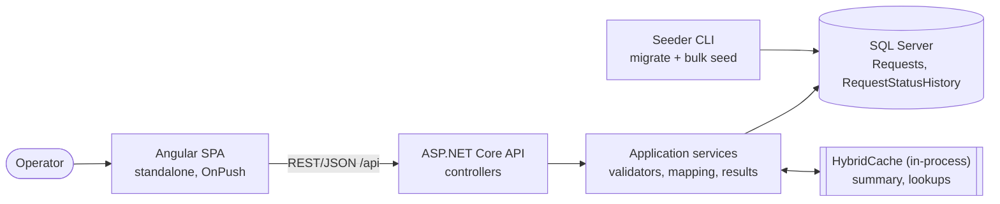
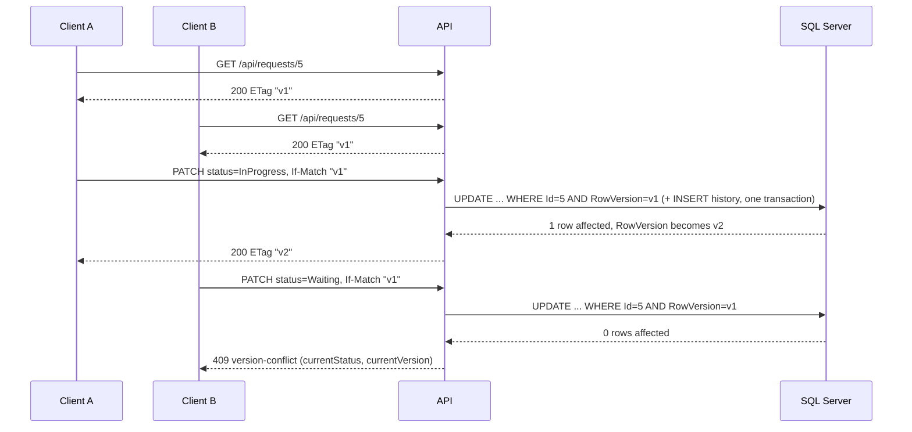

# Request Tracker

[](https://github.com/RuthGinsberger/request-tracker/actions/workflows/ci.yml)

An enterprise-style request-management system for a "Developer Level C" full stack assignment: **.NET 10 + SQL Server + Angular 22**. It holds 100,000+ requests and lets many users find, filter, view and update them, with all filtering, sorting and paging done in the database, optimistic concurrency enforced by SQL Server, a status audit trail, a partial-success bulk update and a small, invalidated cache.

| PDF section | What was built | Where to look |
|---|---|---|
| Domain and data | `Request` + `RequestStatusHistory`, 100k+ seeded rows, re-creatable on demand | [Database](#8-database-and-indexes-r61), [Seeder](#3-local-development-without-docker) |
| 1. Data retrieval | `GET /api/requests`: paging (max 100), combined filters, prefix search, 5 sort fields, summary aggregations | [API](#7-api-overview) |
| 2. Status update and concurrency | `PATCH /api/requests/{id}/status` with `If-Match` / `rowversion`, 404 / 400 / 409 / 428 | [Concurrency](#9-concurrency-r62) |
| 3. Change history | Audit row per change, `GET /api/requests/{id}/history` | [Concurrency](#9-concurrency-r62) |
| 4. Bulk | `POST /api/requests/bulk-status`, up to 100 items, Partial Success | [Bulk update](#10-bulk-update-r22-r23-r62) |
| 5. Angular | Debounced search with request cancellation, Loading / Empty / Error states, status change with 409 handling, summary, history dialog | [frontend/](frontend), [ARCHITECTURE.md §10](docs/ARCHITECTURE.md#10-frontend-architecture) |
| 6. Performance | 17 scenarios measured on 100k rows, actual execution plans, index list with reasons, bottleneck analysis | [docs/PERFORMANCE.md](docs/PERFORMANCE.md) |
| 7. Cache | HybridCache for the summary (60 s) and lookups (10 min), explicit invalidation | [Cache](#11-cache-r37-r41-r63) |
| 8. Tests | 362 backend tests (216 unit + 146 integration against real SQL Server) and 69 frontend tests | [Running tests](#4-running-tests) |
| 9. Work planning | Features → User stories → Tasks with estimates, dependencies and traceability | [docs/WORK_PLAN.md](docs/WORK_PLAN.md) |
| 10–11. Code quality, documentation | Layered solution, DI, ProblemDetails, logging; this README and `docs/` | [Structure](#6-solution-structure-r60) |

**Contents:** [1 Quick start](#1-quick-start-docker-compose) · [2 Compose details](#2-whats-running-and-useful-commands) · [3 Local development](#3-local-development-without-docker) · [4 Tests](#4-running-tests) · [5 Technologies](#5-technologies-and-versions-r59) · [6 Structure](#6-solution-structure-r60) · [7 API](#7-api-overview) · [8 Database](#8-database-and-indexes-r61) · [9 Concurrency](#9-concurrency-r62) · [10 Bulk](#10-bulk-update-r22-r23-r62) · [11 Cache](#11-cache-r37-r41-r63) · [12 Performance](#12-performance-summary-r14-r32-r36) · [13 Decisions](#13-two-significant-technology-decisions-r64) · [14 Limitations](#14-known-limitations-and-improvements-r65) · [15 Plan and decisions](#15-work-plan-and-decisions-log) · [16 AI usage](#16-ai-usage-r66-r70) · [17 Traceability](#17-requirements-traceability-r0-r70)

---

## 1. Quick start (Docker Compose)

Works on Windows, macOS and Linux with Docker (Compose v2). One command:

```bash
docker compose up --build
```

Then open **http://localhost:8080**. The stack starts in this order: `db` (SQL Server 2022) → `seeder` (applies the migrations and seeds 100,000 requests only if the table is empty, then exits) → `api` → `ui` (nginx, proxies `/api`). The seeder owns the schema; the API never migrates, so there is no start-up race.

**First run:** typically several minutes, dominated by pulling the base images, building the three images and seeding (the seeding itself takes 10–20 s). Later starts skip seeding and take seconds.

| What | Where |
|---|---|
| UI | http://localhost:8080 |
| API (`/health`, `/api/requests`, ...) | http://localhost:5280 |
| SQL Server (`sa`, password `Dev_Passw0rd!` unless overridden) | `localhost,1433` |

In the UI, pick a user in the toolbar first (the acting user is sent as `X-User-Name` and recorded in the history); a status change without a chosen user is not sent and the UI asks you to pick one.

Reset commands:

```bash
docker compose run --rm seeder --reset     # drop the database, re-migrate and re-seed 100,000 rows
docker compose down -v                     # stop and delete everything, including the SQL Server volume
```

> **Verification note.** Docker is not available on the development machine (hardware virtualization is disabled), so the Compose setup was **not run locally**. It is verified by the `compose-smoke` job in [GitHub Actions](.github/workflows/ci.yml) (`ci/compose-smoke.sh`, checklist in [docs/COMPOSE_SMOKE_CHECKLIST.md](docs/COMPOSE_SMOKE_CHECKLIST.md)): it builds the stack, waits for the seed, checks the UI, a list call (5 items, total 100000), the summary, a status update (200) and the same update again (409), a seeder re-run (no duplicate data) and that the OpenAPI UI is hidden in Production.

## 2. What's running and useful commands

- **OpenAPI UI** is off in the Compose stack (Production). To enable it, copy `.env.example` to `.env`, set `API_ENVIRONMENT=Development` and re-run `docker compose up --build`; then open http://localhost:5280/scalar/v1 (the page loads its script from a CDN, so it needs internet access). The raw document is at `/openapi/v1.json`.
- **Port conflicts / SA password:** copy `.env.example` to `.env` and change `UI_PORT`, `API_PORT`, `DB_PORT` or `MSSQL_SA_PASSWORD` (avoid `;` and `$` in the password: it is embedded in the connection string).
- **Apple Silicon:** SQL Server 2022 runs under emulation; enable "Use Rosetta" in Docker Desktop. The first start is slower.

## 3. Local development without Docker

### Windows (LocalDB), PowerShell, from the repository root

Prerequisites: .NET SDK 10 (`backend/global.json` pins 10.0.100 with roll-forward to the latest feature band), SQL Server Express LocalDB, Node.js ≥ 24.15 for the Angular 22 CLI (see the Node note below).

```powershell
sqllocaldb start MSSQLLocalDB
dotnet tool restore                                                            # once: EF Core tools (dotnet-ef 10.0.12)
dotnet run --project backend/tools/RequestTracker.Seeder -- --reset            # create + migrate + seed 100,000 rows (10-20 s)
dotnet run --project backend/src/RequestTracker.Api                            # API on http://localhost:5280 (Development)
```

In a second terminal:

```powershell
cd frontend
npm ci
npx ng serve                                                                   # UI on http://localhost:4200, /api is proxied to :5280
```

Start the API first: `frontend/proxy.conf.json` forwards `/api` to `http://localhost:5280`. In Development the API serves `GET /health` and the OpenAPI UI at http://localhost:5280/scalar/v1. The default connection string is `Server=(localdb)\MSSQLLocalDB;Database=RequestTracker;Trusted_Connection=True;TrustServerCertificate=True` (`appsettings.Development.json`); override it with the `ConnectionStrings__Default` environment variable.

> **Node note.** Angular 22's CLI needs Node ≥ 24.15. If `node -v` is older (this project's dev machine has 24.13.0), prefix every frontend command with `npx -p node@24`, e.g. `npx -p node@24 ng serve`; nothing is installed on the machine. With Node ≥ 24.15, no prefix is needed.

Seeder options (all verified with `--help`): `--count <n>` (default 100000), `--seed <n>` (default 42), `--anchor yyyy-MM-dd` (the date taken as "now"; default today UTC, pin it to reproduce identical data across days), `--reset` (drop + migrate + seed), `--if-empty` (no-op when data exists; used by Compose). Without `--reset` / `--if-empty`, a non-empty table is refused (exit 1); usage errors exit 2; Ctrl+C rolls back (exit 130).

### macOS / Linux (or Windows without LocalDB): only the `db` service from Compose

```bash
docker compose up -d db                                  # SQL Server 2022 on localhost,1433 (wait until healthy: docker compose ps)
export ConnectionStrings__Default='Server=localhost,1433;Database=RequestTracker;User Id=sa;Password=Dev_Passw0rd!;TrustServerCertificate=True'
dotnet tool restore
dotnet run --project backend/tools/RequestTracker.Seeder -- --reset
dotnet run --project backend/src/RequestTracker.Api      # http://localhost:5280
# second terminal:
cd frontend && npm ci && npx ng serve                    # http://localhost:4200
```

(PowerShell: `$env:ConnectionStrings__Default = 'Server=localhost,1433;...'`.) If you changed `MSSQL_SA_PASSWORD` in `.env`, use that password.

### Database migrations (developers)

```powershell
dotnet dotnet-ef migrations add <Name> --project backend/src/RequestTracker.Infrastructure --startup-project backend/src/RequestTracker.Api --output-dir Persistence/Migrations
dotnet dotnet-ef database update --project backend/src/RequestTracker.Infrastructure --startup-project backend/src/RequestTracker.Api
```

The design-time factory reads `ConnectionStrings__Default`, else falls back to LocalDB.

## 4. Running tests

```powershell
dotnet build backend/RequestTracker.slnx
dotnet test backend/RequestTracker.slnx                                         # 216 unit + 146 integration
dotnet format backend/RequestTracker.slnx --verify-no-changes                   # formatting gate
cd frontend
npx ng lint
npx ng test --watch=false                                                       # 69 tests (Vitest on jsdom, no browser needed)
npx ng build
```

(Add the `npx -p node@24` prefix to the frontend commands if Node is older than 24.15.)

**Integration tests run against a real SQL Server**, chosen by the `INTEGRATIONTESTS_SQLSERVER` environment variable: a full connection string (anything containing `=`) or just a server name, which is used with Windows authentication. Default: LocalDB `(localdb)\MSSQLLocalDB`. Each run creates its own database `RequestTracker_Tests_<guid>` (through the real migrations), cleans rows between tests with Respawn and drops the database at the end, so it never touches your dev data. Docker/Testcontainers are not used.

```powershell
$env:INTEGRATIONTESTS_SQLSERVER = '(localdb)\MSSQLLocalDB'                       # a server name (Windows auth)
$env:INTEGRATIONTESTS_SQLSERVER = 'Server=localhost,1433;User Id=sa;Password=Dev_Passw0rd!;TrustServerCertificate=True'   # or a full connection string (e.g. the Compose db service)
dotnet test backend/tests/RequestTracker.IntegrationTests
dotnet test backend/tests/RequestTracker.UnitTests                              # unit tests need no database
```

```bash
export INTEGRATIONTESTS_SQLSERVER='Server=localhost,1433;User Id=sa;Password=Dev_Passw0rd!;TrustServerCertificate=True'   # macOS / Linux
```

**What CI runs** ([.github/workflows/ci.yml](.github/workflows/ci.yml), on every push and pull request): (1) *backend*: restore, Release build with warnings as errors, `dotnet format --verify-no-changes`, all unit and integration tests against a **SQL Server 2022 service container on Linux**; (2) *frontend*: `npm ci`, `ng lint`, `ng test`, `ng build`; (3) *compose-smoke*: the Docker Compose stack described in section 1.

### Tests mapped to the required scenarios (R42)

| Req | Scenario | Tests (xUnit unless noted) |
|---|---|---|
| **R42a** happy path | Retrieval with filters, search, sort, paging | `ListRequestsTests`: `Default_query_returns_first_page_sorted_by_createdAt_descending`, `Paging_returns_metadata_and_pages_concatenate_to_the_full_ordered_list`, `Filters_combine_with_and`, `Search_matches_title_or_organization_prefix`, `Each_sort_field_ascending_and_descending_with_stable_tie_breaker` |
| | Status update | `ChangeStatusTests.Happy_path_updates_status_version_and_etag_and_writes_one_history_row`, `The_returned_etag_can_be_used_for_the_next_change` |
| **R42b** validation | Invalid input and transitions | `ListRequestsTests.Invalid_parameter_returns_400_validation_problem_naming_the_field`, `Too_long_values_return_400_naming_the_field`; `ChangeStatusTests.Invalid_transition_returns_400_and_has_no_side_effects`, `Missing_if_match_returns_428`, `Malformed_if_match_returns_400_invalid_version`; `BulkStatusTests.Duplicate_ids_are_400_and_nothing_is_processed`, `More_than_100_items_is_400_and_nothing_is_processed`; unit: `StatusTransitionPolicyTests` (every cell of the table), `RequestListQueryValidatorTests`, `BulkStatusBodyValidatorTests` |
| **R42c** concurrency conflict | Competing updates | `ChangeStatusTests.Parallel_updates_with_the_same_version_let_exactly_one_win` (N real parallel requests: exactly one 200, the rest 409, one history row), `Parallel_updates_to_different_targets_still_let_exactly_one_win`, `Stale_version_returns_409_with_current_status_and_version_and_changes_nothing`, `Version_conflict_is_reported_before_an_invalid_transition`; `BulkStatusTests.Mixed_batch_reports_exact_outcomes_in_request_order`; frontend: the 409 flow in `requests-http-flows.spec.ts` and `status-update.service.spec.ts` |
| **R42d** API + DB | `WebApplicationFactory` + real SQL Server | all 146 tests in `backend/tests/RequestTracker.IntegrationTests` (real migrations, real `rowversion`, real transactions) |
| R25, R26, R28 (A24) | RxJS pipeline and 409 over `HttpTestingController` | `requests-http-flows.spec.ts` (debounce, cancelled in-flight request, distinct terms, error and retry, `If-Match` header, 409, 200), `requests-list.store.spec.ts` |

## 5. Technologies and versions (R59)

Read from `backend/global.json`, `backend/Directory.Build.props`, `backend/Directory.Packages.props`, `.config/dotnet-tools.json`, `frontend/package.json` and `frontend/package-lock.json`, the Dockerfiles and `docker-compose.yml`.

| Area | Technology | Version |
|---|---|---|
| Runtime / SDK | .NET (target `net10.0`, nullable on, warnings as errors) | SDK 10.0.100 pinned with `latestFeature` roll-forward (10.0.401 on the dev machine) |
| Web | ASP.NET Core controllers, `Microsoft.AspNetCore.OpenApi` | 10.0.12 |
| API UI | `Scalar.AspNetCore` (OpenAPI UI, Development only) | 2.17.14 |
| Data | EF Core + `Microsoft.EntityFrameworkCore.SqlServer`; EF tools (`dotnet-ef`, local tool) | 10.0.12 |
| Database | SQL Server: LocalDB for local dev and tests (reports 15.0.4382.1, i.e. SQL Server 2019 Express engine); SQL Server 2022 container for Compose and CI | `mcr.microsoft.com/mssql/server:2022-latest` |
| Validation | FluentValidation (`DependencyInjectionExtensions`) | 12.1.1 |
| Cache | `Microsoft.Extensions.Caching.Hybrid` (in-process L1) | 10.10.0 |
| Backend tests | xUnit 2.9.3, `Microsoft.NET.Test.Sdk` 17.14.1, `Microsoft.AspNetCore.Mvc.Testing` 10.0.0, Respawn 7.0.0, coverlet.collector 6.0.4 | (no FluentAssertions, no Testcontainers) |
| Frontend | Angular (standalone, `OnPush`, strict TypeScript) and Angular Material / CDK | ^22.2 (installed 22.2.1) |
| | RxJS | ~7.8 (installed 7.8.2) |
| | TypeScript | ~6.0 (installed 6.0.3) |
| | Vitest (the scaffolded runner) + jsdom | ^5.0 (installed 5.0.3), ^30.0 |
| | ESLint + angular-eslint + typescript-eslint, Prettier | ^10.9, 22.5.0, 8.69.0, ^3.8 |
| Node.js | Angular 22 CLI minimum ≥ 24.15; CI and the UI image use Node 24 | `node:24-alpine` (image), `24` (CI) |
| Container images | `dotnet/sdk:10.0` (build), `dotnet/runtime:10.0` (seeder), `dotnet/aspnet:10.0` (API), `nginx:1.28-alpine` (UI) | pinned to major/minor |
| CI | GitHub Actions, `actions/checkout@v4`, `setup-dotnet@v4`, `setup-node@v4` | Ubuntu runners |

Deliberately **not** used: AutoMapper, MediatR, generic repositories or a repository layer over EF Core, FluentAssertions v8+ (commercial license), Testcontainers (D-014, D-010).

## 6. Solution structure (R60)

```
backend/
  RequestTracker.slnx                  solution (.slnx format)
  global.json, Directory.*.props       SDK pin, central build settings, central package versions
  Dockerfile                           targets: api, seeder (shared restore/publish stage)
  src/RequestTracker.Domain            Request, RequestStatusHistory, enums, StatusTransitionPolicy (no dependencies)
  src/RequestTracker.Application       DTOs, query/command models, FluentValidation validators, mapping (projection expressions),
                                       services (query, status change, bulk, summary), abstractions (IAppDbContext, IRequestReadCache, ICurrentUser)
  src/RequestTracker.Infrastructure    AppDbContext, entity configurations, migrations, HybridCache implementation
  src/RequestTracker.Api               controllers, ProblemDetails / exception handling, validation filter, header parsing (If-Match, X-User-Name),
                                       DI composition, OpenAPI, /health
  tools/RequestTracker.Seeder          console app: migrate + (re)seed with SqlBulkCopy, deterministic by seed and anchor
  tests/RequestTracker.UnitTests       domain, validators, mapping, parsing, seeder (216)
  tests/RequestTracker.IntegrationTests  API + real SQL Server via WebApplicationFactory (146)
frontend/                              Angular app: core/ (models, API service, interceptors, current user), features/requests/ (page, store,
                                       filters, table, summary, status update, history), Dockerfile + nginx.conf, proxy.conf.json
docs/                                  ARCHITECTURE.md, WORK_PLAN.md, PERFORMANCE.md, REVIEW.md, COMPOSE_SMOKE_CHECKLIST.md, performance/ (raw results + .sqlplan files)
perf/                                  PowerShell + SQL scripts that produced the numbers in PERFORMANCE.md
ci/compose-smoke.sh                    the Compose smoke test run by CI
.github/workflows/ci.yml               CI pipeline
docker-compose.yml, .env.example       one-command run for evaluators and CI
REQUIREMENTS.md, PLAN.md, DECISIONS.md, CLAUDE.md   requirements (source of truth), task status, decision log, working rules
```

Dependency direction (enforced by project references): `Api → Application, Infrastructure`; `Infrastructure → Application, Domain`; `Application → Domain`; `Seeder → Infrastructure`.



Conventions (full detail in [docs/ARCHITECTURE.md](docs/ARCHITECTURE.md) and [CLAUDE.md](CLAUDE.md)): the API returns DTOs only; reads use `AsNoTracking` + `Select` projection with one manual mapping per DTO; expected business outcomes (not found, conflict, invalid transition) are explicit result types, not exceptions; unexpected failures become `500` ProblemDetails through one `IExceptionHandler`; `CancellationToken` flows to every I/O call; times are UTC from an injected `TimeProvider`; logging uses message templates and never logs bodies, header values or connection strings; DbContext and services are scoped, `TimeProvider` and `HybridCache` singleton.

## 7. API overview

Base path `/api`, JSON camelCase, enums as strings, UTC ISO 8601 timestamps. Every error is `application/problem+json` with `type`, `title`, `status`, `detail`, `errorCode` and `traceId` (validation errors add an `errors` dictionary). Interactive documentation: **http://localhost:5280/scalar/v1** (Development only; document at `/openapi/v1.json`). The full contract, check orders and edge-case table are in [docs/ARCHITECTURE.md §5 and §13](docs/ARCHITECTURE.md#5-api-contract).

| Method and path | Purpose | Notable responses |
|---|---|---|
| `GET /api/requests` | Page of requests. Query: `search` (prefix on Title or OrganizationName), `status` and `priority` (repeatable), `organizationName`, `assignedTo` (exact), `createdFrom` / `createdTo` (`yyyy-MM-dd`, on `CreatedAt`), `sortBy` (`createdAt` default, `updatedAt`, `priority`, `status`, `title`), `sortDirection` (`desc` default / `asc`), `page` (1–1,000,000), `pageSize` (1–100, default 20) | 200 `{items, page, pageSize, totalCount, totalPages}`; 400 on any invalid parameter (page size is rejected, not clamped); a page past the end is 200 with empty `items` |
| `GET /api/requests/{id}` | One request, with `ETag: "<version>"` | 200, 404, 400 (`id < 1`) |
| `GET /api/requests/summary` | Global counts by status and by priority (cached, `generatedAtUtc` shows freshness) | 200 |
| `GET /api/lookups` | Distinct organizations and assignees for the filter pickers and user picker (cached) | 200 |
| `PATCH /api/requests/{id}/status` | Body `{"status": "InProgress"}`; headers `If-Match` (required) and `X-User-Name` (required) | 200 + new `ETag`; 400 `invalid-status-transition` / `invalid-version` / validation; 404; **409 `version-conflict`**; 428 `precondition-required` |
| `GET /api/requests/{id}/history` | Status changes of one request, newest first | 200 (`[]` when none), 404 |
| `POST /api/requests/bulk-status` | Body `{"targetStatus", "items": [{"id", "version"}]}` (1–100 items); header `X-User-Name` | 200 with per-item results (Partial Success); 400 for a malformed whole request |
| `GET /health` | Liveness + database check | 200 / 503 |

Allowed status transitions: New → InProgress; InProgress → Waiting; Waiting → InProgress; InProgress → Completed; Waiting → Completed. `Completed` is terminal; setting the same status again is rejected. The rule lives only in `StatusTransitionPolicy` (Domain) and is used by both the single and the bulk update.

There is no authentication (out of scope, A8): the acting user is the required `X-User-Name` header (trimmed, 1–100 characters), chosen in the UI's user picker.

## 8. Database and indexes (R61)

**Choice: SQL Server** (EF Core 10, `rowversion`). Why: concurrency is enforced by the database itself with a native `rowversion` column that SQL Server changes on every update, so application code cannot forget to bump it (R18) and the check is atomic under the row lock (R19); the access paths here are relational filters, sorts and counts over a few indexed columns, where a mature optimizer with **actual execution plans** gives verifiable evidence (R33); status change plus audit row is a plain ACID transaction. The alternative considered, MongoDB, is in [section 13](#13-two-significant-technology-decisions-r64).

Schema: `Requests` (Id `int` identity PK, Title, OrganizationName, Status `tinyint`, Priority `tinyint`, AssignedTo nullable, CreatedAt, UpdatedAt, `RowVersion rowversion`) and `RequestStatusHistory` (Id `bigint`, RequestId FK, PreviousStatus, NewStatus, ChangedAt, ChangedBy). Enums are `tinyint` with CHECK constraints (compact indexes, numeric order = business order) and strings in JSON. Details: [ARCHITECTURE.md §2](docs/ARCHITECTURE.md#2-data-model).

**Indexes** (final list after measuring on 100,000 rows; the reason and the evidence for each is in [PERFORMANCE.md §4](docs/PERFORMANCE.md#4-index-decisions-r34)):

| Index | Key (INCLUDE) | Why |
|---|---|---|
| `PK_Requests` (clustered) | `Id` | Lookup by id, status update, key lookups from other indexes |
| `IX_Requests_CreatedAt` | `CreatedAt` (INCLUDE Title, OrganizationName, Status, Priority, AssignedTo, UpdatedAt, RowVersion) | Default sort and date range; **covers the list projection**, so an ordered scan stops after one page with no lookups (page 1: 182 → 6 reads) |
| `IX_Requests_Status_CreatedAt` | `Status, CreatedAt` | Count of status + date range (10 vs 250 reads) |
| `IX_Requests_Status_Priority` | `Status, Priority` | Count of status + priority (10 vs 1,975 reads) |
| `IX_Requests_OrganizationName_CreatedAt` | `OrganizationName, CreatedAt` | Exact organization filter, organization half of prefix search, distinct organizations |
| `IX_Requests_AssignedTo_CreatedAt` | `AssignedTo, CreatedAt` | Exact assignee filter (count 17 vs 1,975 reads) |
| `IX_Requests_Title` | `Title` | Prefix search `LIKE 'term%'` and sort by title |
| `IX_Requests_UpdatedAt`, `IX_Requests_Priority`, `IX_Requests_Status` | one column each | Sort by those columns: 2,010 reads and a full sort (207–266 ms) became 178–191 reads (1–4 ms); also the narrowest indexes for counts |
| `IX_RequestStatusHistory_RequestId_ChangedAt` | `RequestId, ChangedAt` | History of one request, newest first, no sort |

Text search is prefix-only (`LIKE 'term%'`, wildcards escaped) so it is index-friendly (A4); full-text search is the documented improvement. The clustered key `Id` is appended to every non-clustered index and is the tie-breaker of every sort, which is why a sorted page is an ordered scan that stops early.

**Seed data:** `dotnet run --project backend/tools/RequestTracker.Seeder -- --reset` (10–20 s for 100,000 rows with all indexes, `SqlBulkCopy` in 10,000-row batches inside one transaction). Skewed, realistic distributions (300 organizations, about 40 assignees plus unassigned New requests, 24 months of `CreatedAt`), deterministic by `--seed` and `--anchor`; no seeded history.

## 9. Concurrency (R62)

**Mechanism.** `Requests.RowVersion` is a SQL Server `rowversion`, mapped as an EF Core concurrency token. The API exposes it as the `version` field and the `ETag` header. A client must send the version it last saw in **`If-Match`**; the server enforces it, never the UI.



**Why lost updates are impossible.** The decisive check is the `WHERE RowVersion = @expected` predicate inside the `UPDATE`, executed atomically by SQL Server under its row lock. Of N writers holding the same version, the first commit changes the version; the other N−1 match zero rows, EF raises `DbUpdateConcurrencyException`, and each gets `409`. An earlier in-memory comparison only produces a precise error body and saves a write; correctness never depends on it (D-023, D-051). The integration test `Parallel_updates_with_the_same_version_let_exactly_one_win` fires real parallel requests at a real SQL Server and asserts exactly one `200`, N−1 `409` and exactly one history row.

**Consistency (R18, R20).** The status, `UpdatedAt` (from `TimeProvider`, UTC) and the new `RowVersion` change in the same `UPDATE`; the audit row (`RequestId`, `PreviousStatus`, `NewStatus`, `ChangedAt`, `ChangedBy`) is inserted in the same `SaveChanges`, so state and history commit or roll back together.

**The contract.** Checks run in this order and the first failure wins:

| Step | Result |
|---|---|
| Invalid id, body status or `X-User-Name` | `400 validation-failed` |
| `If-Match` missing | `428 precondition-required` (clients must opt in, so nobody overwrites by omission) |
| `If-Match` malformed, `*` or weak | `400 invalid-version` |
| Request does not exist | `404 not-found` |
| Version differs from the current row (checked early) or the `UPDATE` matches 0 rows (race) | **`409 version-conflict`** with `currentStatus` and `currentVersion`, so the client can refresh without another call |
| Transition not allowed, same status, or `Completed` | `400 invalid-status-transition` |
| Success | `200` with the updated DTO and the new `ETag` |

409 rather than the HTTP-purist 412 follows the assignment's wording ("Conflict", R17); this is D-017.

Real example from the running API (the second call used the old version):

```http
PATCH /api/requests/5/status        If-Match: "AAAAAAAAB9U="   X-User-Name: dana     {"status":"Waiting"}

HTTP/1.1 409 Conflict
{"type":"urn:requesttracker:error:version-conflict","title":"The request was modified by someone else.","status":409,
 "detail":"Request 5 no longer has the version you sent. Reload it and try again.",
 "currentStatus":"InProgress","currentVersion":"AAAAAAABnhE=","errorCode":"version-conflict","traceId":"00-..."}
```

**History (R21).** `GET /api/requests/{id}/history` returns the changes newest first (`ChangedAt` desc, then `Id` desc), `[]` when there are none and `404` for an unknown request.

**In the UI,** a `409` shows "changed by someone else", reloads that row from the server and refreshes the summary; it never retries automatically, so a decision made on stale data is never silently applied (D-067).

## 10. Bulk update (R22, R23, R62)

`POST /api/requests/bulk-status` updates up to **100** requests in one call. Every item carries its own expected `version`; all items move to the same `targetStatus`.

**Decision (R23): Partial Success.** Each item succeeds or fails on its own. Why: the items are unrelated requests edited by different people. One stale or already-completed row must not discard the other 99 valid changes. With All-or-Nothing, a batch of 100 under concurrent use would fail almost every time, and its only benefit (atomicity across unrelated rows) has no business meaning here. The per-item outcome tells the client exactly what to reload and retry; failed items are never partially applied.

**How:** one query loads all ids; items are walked in request order and each goes through the same component as the single update (`RequestStatusChanger`: version check, transition rule, one `SaveChanges` for status + audit, `RowVersion` predicate). A concurrent single update during the bulk therefore appears as `conflict` for that item and the loop continues. The summary cache is invalidated once, and only if at least one item was updated.

**Response contract.** Whole-request problems (0 or more than 100 items, duplicate ids, malformed version, bad `targetStatus`, missing `X-User-Name`) are `400` and **nothing is processed**. Otherwise it is **`200`** (not `207`: poor client/proxy support; the request itself was valid) with a summary and a result per item, in request order. `outcome` is `updated | notFound | conflict | invalidTransition`; `newVersion` only for `updated`, `message` only for failures. Real response from the running API (item 5 had a stale version, 99999999 does not exist):

```json
{ "summary": { "requested": 3, "updated": 1, "notFound": 1, "conflict": 1, "invalidTransition": 0 },
  "results": [
    { "id": 6,        "outcome": "updated",  "newVersion": "AAAAAAABnhI=" },
    { "id": 99999999, "outcome": "notFound", "message": "Request 99999999 does not exist." },
    { "id": 5,        "outcome": "conflict", "message": "Request 5 was modified by someone else." } ] }
```

`200` therefore does not mean "everything worked": clients read `summary` / `results`. Retrying only the failed items is safe. **Trade-off:** up to 100 small transactions per call; a set-based `UPDATE ... OUTPUT` would be faster but cannot classify conflicts per row (D-054, D-018). The UI does not expose bulk update (the assignment's Angular section does not require it).

## 11. Cache (R37-R41, R63)

| What | Why cached (R40) | TTL (R38) | Invalidation (R39) |
|---|---|---|---|
| **Summary** (counts by status and priority) | Full-table aggregate over 100k+ rows, identical for every user, read on every page load, changed only by the comparatively rare status update; measured cache miss ≈ 100 ms vs hit ≈ 1 ms | 60 s absolute (`Cache:SummaryTtlSeconds`) | Tag `summary` removed after every **committed** single update and once per bulk call that updated something; never before commit, never on 404 / 409 / 400 |
| **Lookups** (organizations, assignees) | Two DISTINCT scans of wide columns that no endpoint can change | 10 min absolute (`Cache:LookupsTtlMinutes`) | TTL only |

List queries are deliberately **not** cached: the key space (filters × sort × page) is huge and the hit rate would be low. Implementation: in-process `HybridCache` (stampede-protected `GetOrCreateAsync`) behind `IRequestReadCache`; TTLs are validated at start-up (a zero TTL would silently disable caching).

**Known race.** A read that started before a commit can finish after the invalidation and re-cache the pre-commit value. The window is bounded by the TTL (≤ 60 s), and `generatedAtUtc` makes the age visible; strict consistency (versioned keys or write-through) would be over-engineering for an advisory aggregate.

**Multiple server instances (R41).** Each instance has its own in-process cache, so an update handled by instance A clears only A; B and C keep serving the old summary until their TTL expires (at most 60 s), and may show different numbers meanwhile. Options: (a) accept it, with the TTL as the bound (**current choice**); (b) register a distributed L2 cache such as Redis (`AddStackExchangeRedisCache`, which HybridCache uses automatically) so values are shared, plus a pub/sub backplane that broadcasts tag invalidations so every instance drops its L1 (HybridCache does not do cross-node L1 invalidation itself). (b) is described, not built, and is a composition change in `AddInfrastructure`. Operational note: re-running the seeder while the API runs shows new data in the summary within 60 s, but in lookups only after up to 10 minutes or an API restart.

## 12. Performance summary (R14, R32-R36)

Full analysis, method, plans and caveats: **[docs/PERFORMANCE.md](docs/PERFORMANCE.md)** (scripts in [perf/](perf), raw CSVs and actual `.sqlplan` files in [docs/performance/](docs/performance)). Measured on 100,000 rows on LocalDB (SQL Server 2019 Express engine) on a laptop; **logical reads are the reliable metric**, elapsed times are indicative.

| Operation | Before the index tuning | After (final indexes) |
|---|---|---|
| Default list, page 1, page query (reads) | 182 | **6** |
| Deep page 4000 with a reused plan (reads); through the API p50 | 245,183; 414 ms | **1,582; 93 ms** |
| Common prefix search page (reads) | 1,770 | **14** |
| Sort by `updatedAt` / `priority` / `status` (reads, SQL ms) | 2,010 (207–266 ms) | **178–191 (1–4 ms)** |
| `GET /summary`: cache miss vs hit (API p50) | – | ~100 ms vs ~1.1 ms |
| No secondary index at all (every statement) | 2,010 reads (full scan of 15.7 MB) | – |

Two central operations were tested (the list with filters / search / sort / paging, and the summary; the status-update write cost is in PERFORMANCE.md §4.4). Execution plans (R33) are shown and linked in §3.1; every index and its reason (R34) is in §4; the bottleneck and improvements (R35) are in §7.

**How the solution avoids loading all data into memory (R14, R36).** `RequestQueryService` builds one `IQueryable` from `db.Requests.AsNoTracking()`, adds every filter as a `Where` and terminates it only with database operators: `COUNT(*)` (one integer), then `ORDER BY ... OFFSET ... FETCH NEXT ...` with a `Select` projection to the list DTO. The only materialization holds at most 100 rows (the page-size cap). The summary and lookups use `GROUP BY` / `SELECT DISTINCT`. EF Core throws on a predicate it cannot translate instead of evaluating it on the client, and the seeder streams 10,000-row batches. **How indexes support the main scenarios** is tabulated in [PERFORMANCE.md §6](docs/PERFORMANCE.md#6-no-full-loads-how-the-solution-avoids-loading-all-data-into-memory-r14-r36) (default list: covering `CreatedAt` index; status / priority: ordered scan that stops after 20 matches; organization / assignee: seek on a `(column, CreatedAt)` index; date range: range seek; prefix search: seeks on `Title` and organization indexes; each sort field: its own index).

## 13. Two significant technology decisions (R64)

All 91 decisions with context and trade-offs are in [DECISIONS.md](DECISIONS.md); these two shaped the solution most.

### 13.1 SQL Server with a native `rowversion` (D-002, D-003) vs MongoDB or a manual version column

| Option | For | Against |
|---|---|---|
| **SQL Server + `rowversion` (chosen)** | The DB maintains the token on every write, so it cannot be forgotten; `UPDATE ... WHERE RowVersion = @v` plus the audit insert is one ACID transaction; excellent execution-plan tooling for the performance evidence; EF Core handles the token natively; the data are relational and the queries are filters, sorts and counts | SQL Server-specific; `rowversion` is opaque (base64 in the API); LocalDB is Windows-only, hence the Compose / CI path |
| MongoDB | Flexible schema, easy horizontal scale | No built-in version token (would need a manual `version` field and `findOneAndUpdate` with a filter); multi-document atomicity for status + audit needs transactions (replica set); compound index tuning for combined filter + sort + count is less transparent; nothing in this domain needs a schema-less model |
| SQL Server + manual `int Version` | Portable, readable | Every write path must remember to increment it; a forgotten increment silently breaks R17-R19 |

EF Core over Dapper was decided together with this: built-in concurrency-token handling, migrations, and LINQ composition of the dynamic filters; reads stay lean through `AsNoTracking` + projection, and the generated SQL was inspected and measured.

### 13.2 Offset paging with a total count (D-007, D-041) vs keyset paging

| Option | For | Against |
|---|---|---|
| **Offset + `COUNT` (chosen)** | The UI needs page numbers, "page x of y" and arbitrary jumps; works with any of the five sort fields; trivially simple and testable | Deep pages and large counts cost more as data grows: page 4000 reads 1,582 pages (was 245,183 before the covering index), linear in the page number; two queries per request |
| Keyset (seek) paging | Constant cost at any depth (about the 6 reads of page 1) | No jump to a page number, cursor tied to one sort order (each `sortBy` needs its own index and cursor), total needs a separate query, more complex client |

The cost of the choice is measured and bounded (covering index, [PERFORMANCE.md §7.1](docs/PERFORMANCE.md#71-deep-offset-pages-and-a-plan-compiled-for-page-1-reused-for-page-4000-measured)); keyset paging is the documented improvement for much larger tables.

Other decisions worth a look: Partial Success for bulk (D-006, D-054), 409 instead of 412 (D-017), HybridCache over IMemoryCache / Redis (D-008, D-044), RxJS `switchMap` store without NgRx (D-062, D-063), LocalDB locally and a SQL Server service container in CI instead of Testcontainers (D-010, D-081).

## 14. Known limitations and improvements (R65)

**Known limitations**

1. **Deep offset paging and large counts degrade linearly with table size.** Page 4000 of 100,000 costs about 1,580 reads; at 10 million rows that is about 100 times more, and an unfiltered `COUNT(*)` scans a 138-page index per list request (extrapolated in [PERFORMANCE.md §7.5](docs/PERFORMANCE.md#75-what-breaks-at-10-million-rows-extrapolation-not-measured), not measured). The covering index bounds the worst case but does not remove it.
2. **The cache is per instance.** With several API instances, other instances can show a stale summary for up to 60 s after an update (section 11).
3. **A rare search term costs more reads than before the index tuning** (1 match: 11 → 1,975 reads, 66 ms through the API) because the covering index makes the optimizer prefer an ordered scan for the page query; accepted because the worst case is now bounded. Prefix search cannot match inside a word (A4).
4. **No authentication:** `X-User-Name` is trusted, so `ChangedBy` is not secure evidence of identity.
5. **Not verified here:** Docker Compose is verified only by CI (no Docker locally). I click-tested the UI in a browser, including the two-window 409 flow.
6. Bulk update runs up to 100 small transactions per call and has no UI.

**What could be improved (and the first thing I would do)**

- **Keyset paging** for the list (and an opaque cursor), removing the deep-page and sniffing risk; combine with "has next page" or a cached/approximate count (PERFORMANCE.md §7.1–7.2).
- **SQL Server Full-Text Search** for text search (words anywhere, ranking), accepting asynchronous index population and a different path for LocalDB, which lacks the feature (§7.3).
- **Redis L2 + pub/sub backplane** for consistent cache invalidation across instances.
- Set-based bulk update with `ExecuteUpdate` / `UPDATE ... OUTPUT` if profiling shows the per-item transactions matter; a bulk UI.
- Real authentication (JWT / OIDC) replacing the header, and creating indexes after the bulk load to speed up seeding at much larger sizes.

## 15. Work plan and decisions log

- **Work plan (R43–R48):** [docs/WORK_PLAN.md](docs/WORK_PLAN.md): 9 features → 10 user stories → 45 tasks with expected output, dependencies, hour estimates (180.5 h, hand-coding effort), requirement IDs, non-coding tasks, a dependency graph and an R0–R70 matrix, plus an "Actual status" column. Execution status of the 18 sessions is in [PLAN.md](PLAN.md).
- **Decisions log:** [DECISIONS.md](DECISIONS.md) (D-001 … D-091, each with context, alternatives, rationale and trade-offs). Requirements and the clarification answers they depend on: [REQUIREMENTS.md](REQUIREMENTS.md).
- **Architecture and API contract:** [docs/ARCHITECTURE.md](docs/ARCHITECTURE.md). **Performance:** [docs/PERFORMANCE.md](docs/PERFORMANCE.md). **Final review (requirement audit, findings fixed, residual risks):** [docs/REVIEW.md](docs/REVIEW.md).

## 16. AI usage (R66, R70)

AI use is allowed and neither costs nor earns points (R70); the candidate is responsible for all submitted code. The description of how AI was used is drawn from `CLAUDE.md`, `PLAN.md`, `DECISIONS.md` and the commit trailers; the statements about what was personally reviewed, checked or changed are the candidate's own.

**Tool and workflow recorded in the repository.** I used two AI tools. **Claude (chat, claude.ai)** helped me turn the Hebrew PDF into the numbered requirements list (R0–R70), plan the 18 tasks, and write one detailed prompt per task. **Claude Code** (Claude Sonnet 5.5) implemented each task in its own session, starting from that prompt. Between tasks I reviewed the summary Claude Code gave me, checked `PLAN.md` and `DECISIONS.md`, and only then started the next task. I did not use other AI tools (no Copilot or other assistants).

**Parts that used AI (from PLAN.md) and what to fill in**

| Part | AI-assisted (per PLAN.md / DECISIONS.md) | Reviewed, verified, changed or rejected by the candidate |
|---|---|---|
| Requirements breakdown, architecture, work plan (Task 2) | Yes: `docs/ARCHITECTURE.md`, `docs/WORK_PLAN.md`, decisions D-017–D-023 | Before any code, I answered a set of clarification questions that fixed the key decisions: SQL Server with rowversion, Partial Success for bulk, the allowed status transitions, the cache scope, and no authentication. I accepted the recommended defaults for these. I read both documents but did not change the estimates or the task breakdown. |
| Domain, EF Core model, migrations, seeder (Tasks 3–4) | Yes | I checked the schema in LocalDB with `sqlcmd`: both tables, all required fields. I read `StatusTransitionPolicy` and checked it against the agreed transition table; in the UI, only allowed statuses appear. I checked the seeded data: 100,000 requests, with the status and priority split close to the planned distribution. I did not change anything in this part. |
| API: list, summary, cache, status update, history, bulk (Tasks 5–9) | Yes | The 409-vs-412 choice and Partial Success for bulk were my decisions during planning. I tried the API by hand with PowerShell: a filtered list, the summary, and the history of a request. I tested concurrency through the UI: I changed the same request from two windows, and the second got 409 Conflict. 
| Angular app and RxJS pipeline (Tasks 10–12) | Yes | I ran the app in a browser against LocalDB and tried search, filters, sorting, paging, the summary, change history, and a status change from two windows, where the second window got the 409 flow and could retry on fresh data. I made some small styling changes to the UI; I did not change the logic or the store. |
| Performance analysis and index tuning (Task 13) | Yes: scripts, runs, `docs/PERFORMANCE.md`, migrations 
| Docker Compose, CI (Tasks 14–15, first CI fix D-085) | Yes |  I checked the CI runs in the GitHub Actions tab. The first run failed because the integration-test connection string in the workflow was missing `Server=`. I passed the log to Claude Code, which fixed it (D-085), and I confirmed that the next runs passed, including the compose-smoke job|
| Tests (all tasks, Task 16 frontend) | Yes | To check that the tests catch real bugs, I allowed a forbidden transition (Completed to New) in `StatusTransitionPolicy` and ran the unit tests: 3 of 216 failed, including `Completed_is_terminal`. I then reverted the change and confirmed that all tests pass again.|
| Documentation (Task 17: this README, docs consistency) | Yes | I read the README and the main documents in `docs/`, checked them against what I saw when running the system, and updated the parts that needed my own input. | 

**Verification that is recorded in the repository** (automated or scripted; this is what the tooling checked, not a statement about manual review): warnings-as-errors build and `dotnet format --verify-no-changes`; 216 unit + 146 integration tests against a real SQL Server (LocalDB locally, SQL Server 2022 container in CI), including a parallel-update test; 69 frontend tests and ESLint; execution plans and logical reads captured for 17 scenarios on 100k rows (`perf/`, `docs/performance/`), including an index-ablation run; the generated SQL inspected in the Development log (D-040, D-071); the first CI run failed on a malformed connection string in the workflow and was fixed without weakening any test (D-085); the Compose files could not be run locally and are checked only by the CI smoke job (D-080). 

**Where the AI output was wrong or needed correcting** The first CI run failed: the integration-test connection string in the workflow was missing `Server=`, so every integration test failed with "Keyword not supported". The value came from the AI-written task prompt. I passed the CI log back to Claude Code, which fixed it (D-085), and the next run passed.

## 17. Requirements traceability (R0-R70)

"Where" points to the implementation or the document; "Tests / evidence" to the automated test (class names under `backend/tests/...IntegrationTests/` or `.../UnitTests/`, frontend specs under `frontend/src/app/`) or the measurement.

| Req | Where implemented or documented | Tests / evidence |
|---|---|---|
| R0 | Whole solution; [section 13](#13-two-significant-technology-decisions-r64), [WORK_PLAN](docs/WORK_PLAN.md) | CI green |
| R1 | Controllers + services; [section 7](#7-api-overview) | `ListRequestsTests`, `ChangeStatusTests` |
| R2 | `Request` entity, `RequestConfiguration` (rowversion, `tinyint` enums); [ARCHITECTURE §2](docs/ARCHITECTURE.md#2-data-model) | `RequestTests` (unit), `GetRequestByIdTests` |
| R3 | `tools/RequestTracker.Seeder`; [section 3](#3-local-development-without-docker) | `RequestGeneratorTests`, `SeederOptionsTests`; 100,000 rows seeded and compared by checksum (D-030) |
| R4 | SQL Server + EF Core; [section 8](#8-database-and-indexes-r61), D-002 | all integration tests |
| R5 | `RequestsController.List`, `RequestQueryService` | `ListRequestsTests` |
| R6 | `Skip`/`Take` in `RequestQueryService`; `PagedResult` | `ListRequestsTests.Paging_returns_metadata_and_pages_concatenate_to_the_full_ordered_list`, `Page_past_the_end_returns_200_with_empty_items_and_true_totals` |
| R7 | `RequestQueryService` filters, date semantics D-021 | `ListRequestsTests.Each_filter_alone`, `Date_range_covers_whole_days`, `Filters_combine_with_and` |
| R8 | `LikePattern`, `EF.Functions.Like` | `ListRequestsTests.Search_matches_title_or_organization_prefix`, `Wildcard_characters_in_search_are_matched_literally`; `ListQueryHelpersTests` |
| R9 | `RequestSorting` (5 whitelisted fields, `Id` tie-breaker) | `ListRequestsTests.Each_sort_field_ascending_and_descending_with_stable_tie_breaker` |
| R10 | `RequestSummaryService`, `GET /api/requests/summary` (counts by status and priority) | `SummaryAndLookupsTests`, `SummaryMappingsTests` |
| R11 | `RequestListQueryValidator` (page size 1–100, all parameters validated) | `RequestListQueryValidatorTests`, `ListRequestsTests.Invalid_parameter_returns_400_validation_problem_naming_the_field`, `Boundary_values_are_accepted` |
| R12 | `CancellationToken` on every controller action and I/O call | `ListRequestsTests.Cancelled_token_stops_the_query`, `ChangeStatusTests.Cancellation_before_the_save_persists_nothing` |
| R13 | DTOs and `RequestMappings`; no entity leaves Application | `GetRequestByIdTests.Response_body_uses_camelCase_and_string_enums_and_no_entity_fields`, `ListRequestsTests.Items_expose_only_dto_fields_with_string_enums_and_version`, `RequestMappingsTests` |
| R14 | [Section 12](#12-performance-summary-r14-r32-r36), [PERFORMANCE §6](docs/PERFORMANCE.md#6-no-full-loads-how-the-solution-avoids-loading-all-data-into-memory-r14-r36) | Generated SQL and plans in `docs/performance/` |
| R15 | `404 not-found` for GET, PATCH, history | `GetRequestByIdTests.Missing_request_returns_404_problem_details`, `ChangeStatusTests.Unknown_request_returns_404`, `History_of_unknown_request_returns_404_and_invalid_id_400` |
| R16 | `StatusTransitionPolicy`, `StatusChangeClassifier`; `400 invalid-status-transition` / validation | `StatusTransitionPolicyTests`, `StatusChangeClassifierTests`, `ChangeStatusTests.Invalid_transition_returns_400_and_has_no_side_effects`, `Invalid_status_in_body_returns_400_validation_error_even_without_if_match` |
| R17 | `RowVersion` predicate in `RequestStatusChanger`; [section 9](#9-concurrency-r62) | `ChangeStatusTests.Parallel_updates_with_the_same_version_let_exactly_one_win`, `Stale_version_returns_409_with_current_status_and_version_and_changes_nothing` |
| R18 | `rowversion` + `UpdatedAt` in one `UPDATE` | `ChangeStatusTests.Happy_path_updates_status_version_and_etag_and_writes_one_history_row` |
| R19 | Server/DB enforcement, `If-Match` required (428) | `ChangeStatusTests.Missing_if_match_returns_428`, parallel-update tests; no UI-only handling |
| R20 | `RequestStatusHistory` written in the same `SaveChanges` | `ChangeStatusTests.Happy_path_...writes_one_history_row`, `Rejected_update_does_not_invalidate_the_summary_cache`, `Invalid_transition_returns_400_and_has_no_side_effects`, `BulkStatusTests.Only_updated_items_get_history_rows` |
| R21 | `GET /api/requests/{id}/history` | `ChangeStatusTests.History_lists_changes_newest_first_with_all_fields`, `History_orders_equal_timestamps_by_id_descending`, `History_of_a_request_without_changes_is_an_empty_array`, `History_only_contains_the_requested_request` |
| R22 | `BulkStatusService`, `POST /api/requests/bulk-status` | `BulkStatusTests.Exactly_100_items_is_accepted`, `More_than_100_items_is_400_and_nothing_is_processed`, `BulkStatusBodyValidatorTests` |
| R23 | [Section 10](#10-bulk-update-r22-r23-r62), D-006, D-054 | `BulkStatusTests.Mixed_batch_reports_exact_outcomes_in_request_order`, `All_items_failing_is_still_200`, `Outcomes_use_camel_case_names_on_the_wire` |
| R24 | Server-side everything: `RequestQueryService`; Angular sends query parameters only | `requests-api.service.spec.ts`, `requests-list.store.spec.ts`, `ListRequestsTests` |
| R25 | `RequestsListStore` (`debounce` 300 ms, trim, `distinctUntilChanged`) | `requests-list.store.spec.ts`, `requests-http-flows.spec.ts` |
| R26 | `switchMap` cancels the in-flight request (D-063) | `requests-http-flows.spec.ts` (request marked cancelled), `requests-list.store.spec.ts` |
| R27 | Loading / Empty / Error (+ retry) in the list, summary and history dialog | `requests-list.store.spec.ts`, `summary-history.stores.spec.ts`, `requests-http-flows.spec.ts` |
| R28 | `StatusUpdateService` (`If-Match`, 409 refresh flow, D-067) | `status-update.service.spec.ts`, `requests-http-flows.spec.ts` |
| R29 | `SummaryStore`, `SummaryComponent` | `summary-history.stores.spec.ts` |
| R30 | `HistoryDialogComponent`, `HistoryStore` | `summary-history.stores.spec.ts` |
| R31 | Components present; stores/services own HTTP and state; [ARCHITECTURE §10](docs/ARCHITECTURE.md#10-frontend-architecture) | `requests-api.service.spec.ts`, `interceptors.spec.ts`, `current-user.service.spec.ts` |
| R32 | [PERFORMANCE §3 and §5](docs/PERFORMANCE.md#3-results-at-sql-level-r32-r33) (list and summary measured on 100k rows) | `perf/` scripts, `docs/performance/*.csv` |
| R33 | [PERFORMANCE §3.1](docs/PERFORMANCE.md#31-execution-plans-actual-plans-saved) | `docs/performance/plans/**/*.sqlplan`, `STATISTICS IO` reads |
| R34 | [PERFORMANCE §4](docs/PERFORMANCE.md#4-index-decisions-r34), [section 8](#8-database-and-indexes-r61) | Ablation results `results-ablation-*.csv`; migrations `InitialCreate`, `CoveringCreatedAtIndex`, `SortColumnIndexes` |
| R35 | [PERFORMANCE §7](docs/PERFORMANCE.md#7-bottlenecks-and-improvements-r35) (deep OFFSET → keyset paging; count; full-text) | Scenario 07 / 07b |
| R36 | Filtering, counting, sorting and paging inside SQL; [section 12](#12-performance-summary-r14-r32-r36) | `ListRequestsTests`; plans |
| R37 | `RequestReadCache` (`IRequestReadCache`): summary and lookups | `SummaryAndLookupsTests.Second_summary_call_is_served_from_cache_until_invalidated` |
| R38 | 60 s / 10 min absolute TTL, `CacheOptions` validated at start | `SummaryAndLookupsTests`; `CacheOptionsValidator` |
| R39 | `InvalidateSummaryAsync` after commit, single and bulk | `ChangeStatusTests.Successful_update_invalidates_the_summary_cache`, `Rejected_update_does_not_invalidate_the_summary_cache`, `BulkStatusTests.Successful_bulk_invalidates_the_summary_cache`, `Bulk_without_any_update_does_not_invalidate_the_cache` |
| R40 | [Section 11](#11-cache-r37-r41-r63), D-047 | Cold vs warm measurements in PERFORMANCE §5 |
| R41 | [Section 11](#11-cache-r37-r41-r63), D-048 | Documentation |
| R42, R42a–R42d | [Section 4](#4-running-tests) mapping table | 362 backend + 69 frontend tests |
| R43–R47 | [WORK_PLAN](docs/WORK_PLAN.md): features, stories, tasks, outputs, dependency graph, estimates, matrix | Documentation |
| R48 | Non-coding tasks in WORK_PLAN: DB design, tests, performance, documentation, run readiness | Documentation |
| R49 | Project structure, [section 6](#6-solution-structure-r60) | Project references enforce the dependency direction |
| R50 | Consistent naming, shared helpers (`QueryValues`, `ApiProblems`, `RequestStatusChanger`) | `dotnet format --verify-no-changes` in CI |
| R51 | DTOs, `RequestMappings` / `SummaryMappings`, entities in separate projects/files | `RequestMappingsTests`, `SummaryMappingsTests` |
| R52 | DI lifetimes: DbContext and services scoped, `TimeProvider` and HybridCache singleton (`DependencyInjection.cs`, `ServiceCollectionExtensions.cs`) | Integration tests run the real container |
| R53 | Async all the way, no `.Result` / `.Wait()` | Compiler warnings as errors; integration tests |
| R54 | `GlobalExceptionHandler`, `ApiProblems` (one ProblemDetails factory), `ValidationFilter` | `GlobalExceptionHandlerTests`, `HealthAndOpenApiTests.Health_is_unhealthy_and_api_calls_return_generic_500_problem_details`, `GetRequestByIdTests.Unknown_route_returns_problem_details_too` |
| R55 | FluentValidation for every input model, one error shape | `RequestListQueryValidatorTests`, `BulkStatusBodyValidatorTests`, `UserNameRulesTests` |
| R56 | `ILogger` message templates at meaningful points; no bodies, headers or connection strings (D-052, D-056) | `HeaderCurrentUserTests`; review of the log statements |
| R57 | No AutoMapper / MediatR / repository layer; four `src` projects only (D-011, D-014) | Structure |
| R58 | Sections [1](#1-quick-start-docker-compose)–[4](#4-running-tests) | CI compose-smoke job; local commands executed |
| R59 | [Section 5](#5-technologies-and-versions-r59) | Versions read from the project files |
| R60 | [Section 6](#6-solution-structure-r60) | – |
| R61 | [Section 8](#8-database-and-indexes-r61) | [PERFORMANCE §4](docs/PERFORMANCE.md#4-index-decisions-r34) |
| R62 | Sections [9](#9-concurrency-r62) and [10](#10-bulk-update-r22-r23-r62) | Concurrency and bulk tests above |
| R63 | [Section 11](#11-cache-r37-r41-r63) | Cache tests above |
| R64 | [Section 13](#13-two-significant-technology-decisions-r64) | [DECISIONS.md](DECISIONS.md) |
| R65 | [Section 14](#14-known-limitations-and-improvements-r65) | [PERFORMANCE §7](docs/PERFORMANCE.md#7-bottlenecks-and-improvements-r35) |
| R66 | [Section 16](#16-ai-usage-r66-r70) | Placeholders for the candidate |
| R67 | One-command Compose, CI, public repository, [sections 1–4](#1-quick-start-docker-compose) | CI badge above; `ci/compose-smoke.sh` |
| R68 | No ZIP files (`*.zip` is in `.gitignore`); source is in the repository | `git ls-files` |
| R69 | Repository layout, README, CI, docs | CI badge |
| R70 | [Section 16](#16-ai-usage-r66-r70) | – |
