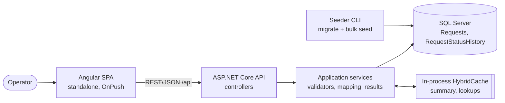
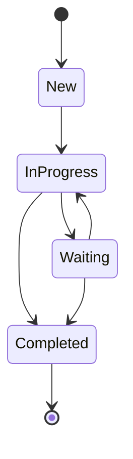
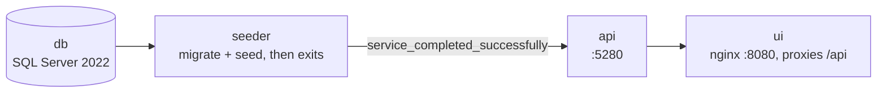

# Architecture

Binding design for the Request Tracker. Every implementation task follows this document; deviations must be logged in `DECISIONS.md` first. Requirement IDs (R#) and clarification answers (A#) refer to `REQUIREMENTS.md`.

## 1. Overview and component diagram



- The UI never filters, sorts or pages data itself (R24); it only sends query parameters.
- The API returns DTOs only (R13). Entities never leave the Application layer.
- The cache is per-process (A17). The Seeder is a separate console app; it is not part of the API process.

## 2. Data model

### `Requests`

| Column | Type | Null | Notes |
|---|---|---|---|
| Id | `int` identity | no | Clustered PK |
| Title | `nvarchar(200)` | no | |
| OrganizationName | `nvarchar(200)` | no | |
| Status | `tinyint` | no | New=1, InProgress=2, Waiting=3, Completed=4 |
| Priority | `tinyint` | no | Low=1, Medium=2, High=3 (numeric order = business order, so `ORDER BY Priority` is meaningful) |
| AssignedTo | `nvarchar(100)` | **yes** | Null = unassigned (see D-019) |
| CreatedAt | `datetime2` | no | UTC |
| UpdatedAt | `datetime2` | no | UTC, set from `TimeProvider` on every status change; equals `CreatedAt` on insert |
| RowVersion | `rowversion` | no | EF concurrency token (`IsRowVersion()`) |

### `RequestStatusHistory`

| Column | Type | Null | Notes |
|---|---|---|---|
| Id | `bigint` identity | no | Clustered PK; unbounded growth |
| RequestId | `int` | no | FK → `Requests.Id`, `NO ACTION` (nothing is ever deleted) |
| PreviousStatus | `tinyint` | no | |
| NewStatus | `tinyint` | no | |
| ChangedAt | `datetime2` | no | UTC; same instant as `Requests.UpdatedAt` of that change |
| ChangedBy | `nvarchar(100)` | no | From `X-User-Name` |

### Enums: tinyint in the DB, strings in JSON

- **DB:** `tinyint` is 1 byte, compact in indexes, sorts numerically, and a value outside the enum is rejected by a `CHECK` constraint. EF maps the enum with `HasConversion<byte>()`.
- **JSON:** enums are serialized as strings (`"InProgress"`) via `JsonStringEnumConverter` so the contract is readable, stable if the numeric values change, and self-documenting in OpenAPI. Unknown strings are rejected with 400, never coerced.
- Because Priority/Status numeric order is meaningful, sorting by them is done in the DB on the numeric column.

## 3. Status transitions (A7)

| From \ To | New | InProgress | Waiting | Completed |
|---|---|---|---|---|
| **New** | ✗ | ✓ | ✗ | ✗ |
| **InProgress** | ✗ | ✗ (same) | ✓ | ✓ |
| **Waiting** | ✗ | ✓ | ✗ (same) | ✓ |
| **Completed** | ✗ | ✗ | ✗ | ✗ (terminal) |

Setting the same status again is rejected. Nothing can move back to `New`. `Completed` is terminal. The rule lives only in `StatusTransitionPolicy` (Domain) and is used by the single update and the bulk update.



## 4. Index plan (initial hypotheses; verified and revised in Task 13, see docs/PERFORMANCE.md)

All indexes are non-clustered unless noted. The table below is the plan made before measuring; **Task 13 measured every row on 100k records and changed two things**, listed under the table. The final list with the evidence for each index is in [docs/PERFORMANCE.md](PERFORMANCE.md) section 4 (R34).

| Index | Columns | Query pattern served | Reason / expected effect |
|---|---|---|---|
| PK (clustered) | `Id` | `GET /requests/{id}`, key lookups | Unique, narrow, ever-increasing: no page splits on insert |
| `IX_Requests_CreatedAt` | `CreatedAt` | Default list (sort by createdAt desc, no filter), date range | Ordered scan lets `OFFSET/FETCH` stop early instead of sorting 100k rows |
| `IX_Requests_Status_CreatedAt` | `Status, CreatedAt` | Filter by status + default sort/date range | Seek on Status then ordered range on CreatedAt. Status has only 4 values, so on its own it is low-selectivity (≈25% of rows per value) and the optimizer may prefer a scan; paired with CreatedAt it supplies the sort order, which is where the benefit comes from |
| `IX_Requests_OrganizationName_CreatedAt` | `OrganizationName, CreatedAt` | Exact organization filter, org prefix search | High selectivity (many orgs): seek + ordered range. Also serves `SELECT DISTINCT OrganizationName` for lookups |
| `IX_Requests_AssignedTo_CreatedAt` | `AssignedTo, CreatedAt` | Exact assignee filter | High selectivity; also serves distinct assignees for lookups |
| `IX_Requests_Title` | `Title` | Prefix search `Title LIKE 'term%'` | Index seek on a range; `%term%` would force a scan (A4). Title is `nvarchar(200)` = 400 bytes, within the 1700-byte key limit |
| `IX_Requests_Status_Priority` | `Status, Priority` | Aggregations (counts by status, by priority), priority filter | Narrow covering index: both `GROUP BY` queries scan this small index instead of the clustered table. Priority (3 values) alone would be low-selectivity and is not indexed by itself |
| `IX_RequestStatusHistory_RequestId_ChangedAt` | `RequestId, ChangedAt` | History of one request, newest first | Seek on RequestId, read in order, no sort. The `Id` tiebreaker is satisfied because the clustered key `Id` is appended to every non-clustered index |

**Outcome of Task 13 (migrations `CoveringCreatedAtIndex`, `SortColumnIndexes`).** (1) `IX_Requests_CreatedAt` now has `INCLUDE (Title, OrganizationName, Status, Priority, AssignedTo, UpdatedAt, RowVersion)`: it covers the list projection, which removed the per-row key lookups (page 1: 186 → 6 reads; deep page 4000 with a reused plan: 245,183 → 1,582). (2) Three single-column indexes were added for the sortable columns nothing else orders: `IX_Requests_UpdatedAt`, `IX_Requests_Priority`, `IX_Requests_Status` (sort by those columns: 2,010 reads and a full sort, 207-266 ms, became 178-191 reads, 1-4 ms). No planned index was removed: each was shown to be the cheapest access path for at least one statement (ablation in PERFORMANCE.md section 4.3). The "known gaps" below were measured; sorting is now indexed, deep offsets and counts remain the documented bottlenecks.

Known gaps by design (measured in Task 13; the sort gap is closed by the new sort indexes, the rest remain the documented bottlenecks): sorting by `updatedAt`, `priority`, `status` or `title` combined with a filter that is not the leading index column requires a sort; `COUNT(*)` with a multi-column filter touches many rows; `OFFSET` for deep pages reads and discards rows. The documented improvements are keyset paging and, for text, full-text search (A4, A16).

Write cost: 9 non-clustered indexes on `Requests` (6 planned, one of them widened, plus 3 sort indexes) slow inserts (seeding 100k rows went from ~7 s to 10–17 s) and make a status update touch more index entries (11 → 22 logical reads), but the table is read-heavy and only `Status`/`UpdatedAt` change after insert (measured in PERFORMANCE.md section 4.4).

## 5. API contract

Conventions: base path `/api`; JSON camelCase; enums as strings; dates as ISO 8601 UTC (`2026-01-31T09:15:00Z`); `version` is the base64 form of the 8-byte `rowversion`. All errors use `application/problem+json` (RFC 9457 `ProblemDetails`, `ValidationProblemDetails` for 400 validation). Every error carries `type` = `urn:requesttracker:error:{errorCode}`, `title`, `status`, `detail`, `traceId`, and the extension `errorCode`.

| `errorCode` | Status | Meaning |
|---|---|---|
| `validation-failed` | 400 | Invalid query/body/header (`errors` dictionary keyed by field) |
| `invalid-version` | 400 | `If-Match` malformed, `*`, or weak |
| `invalid-status-transition` | 400 | Transition not allowed or same status |
| `not-found` | 404 | Request does not exist |
| `version-conflict` | 409 | Stale version |
| `precondition-required` | 428 | `If-Match` missing |
| `internal-error` | 500 | Unexpected failure (no internals leaked) |

### DTOs

```jsonc
// RequestListItemDto and RequestDetailsDto (same fields, separate types so they can diverge)
{ "id": 42, "title": "…", "organizationName": "…", "status": "InProgress", "priority": "High",
  "assignedTo": "dana" /* or null */, "createdAt": "…Z", "updatedAt": "…Z", "version": "AAAAAAAAB9E=" }

// PagedResult<T>
{ "items": [ /* T */ ], "page": 1, "pageSize": 20, "totalCount": 100000, "totalPages": 5000 }

// StatusHistoryItemDto
{ "id": 7, "requestId": 42, "previousStatus": "New", "newStatus": "InProgress", "changedAt": "…Z", "changedBy": "dana" }
```

### `GET /api/requests`

| Parameter | Rules |
|---|---|
| `search` | Optional. Trimmed; empty/whitespace = no search. Max 100 chars (after trim). Prefix match on `Title` **OR** `OrganizationName`. `%`, `_`, `[` and `\` are escaped and matched literally |
| `status` | Optional, repeatable (`status=New&status=Waiting`), OR within the parameter. Unknown value → 400 |
| `priority` | Optional, repeatable, same rules |
| `organizationName` | Optional, exact match (A9), max 200 |
| `assignedTo` | Optional, exact match (A9), max 100. Filtering for "unassigned" is not supported (A10) |
| `createdFrom`, `createdTo` | Optional dates `yyyy-MM-dd`, applied to `CreatedAt` only (A12). `createdFrom` inclusive from 00:00:00 UTC; `createdTo` inclusive through the end of that day (implemented as `CreatedAt < createdTo + 1 day`). `createdFrom ≤ createdTo` else 400 |
| `sortBy` | `createdAt` (default), `updatedAt`, `priority`, `status`, `title`; case-insensitive; unknown → 400 |
| `sortDirection` | `desc` (default), `asc`; unknown → 400 |
| `page` | integer 1–1,000,000, default 1 |
| `pageSize` | integer 1–100, default 20 |

- All filters combine with AND. Sorting always appends `Id` in the same direction as a tiebreaker so paging is deterministic.
- Response `200 PagedResult<RequestListItemDto>`. A page past the end returns **200 with empty `items`** and the true `totalCount`/`totalPages` (`totalPages` = 0 when there are no matches).
- `400` `validation-failed`: any rule above.

### `GET /api/requests/{id}`

`200 RequestDetailsDto` with header `ETag: "<base64 rowversion>"`; `404 not-found`; `400` if `id < 1`.

### `GET /api/requests/summary`

```json
{ "totalCount": 100000,
  "byStatus": [ { "status": "New", "count": 0 }, "… all 4 members, fixed order …" ],
  "byPriority": [ { "priority": "Low", "count": 0 }, "… all 3 members …" ],
  "generatedAtUtc": "…Z" }
```

All enum members are present, including zeros. Global (not filter-aware, A11). Served from cache; `generatedAtUtc` is when the value was computed, so clients can see staleness. `200` only.

### `GET /api/lookups`

`200 { "organizations": ["…"], "assignees": ["…"] }`, distinct, sorted ordinal-ignore-case ascending, null assignees excluded. Used for the exact-match filter pickers and the user picker (A8). Cached with TTL only: no endpoint mutates these fields (A10).

### `PATCH /api/requests/{id}/status`

- Body: `{ "status": "InProgress" }`.
- Headers: `If-Match` required, a strong ETag = quoted base64 rowversion (`"AAAAAAAAB9E="`); `X-User-Name` required, trimmed, 1–100 chars.
- **Check order (first failure wins):**
  1. Input validation → `400 validation-failed` (id < 1, missing/invalid `X-User-Name`, missing/unknown `status`).
  2. `If-Match` absent → `428 precondition-required`.
  3. `If-Match` malformed (not a quoted base64 of 8 bytes; includes `*` and weak `W/"…"`) → `400 invalid-version`.
  4. Request does not exist → `404 not-found`.
  5. Version differs from the current row → `409 version-conflict`, ProblemDetails with extensions `currentStatus` and `currentVersion`.
  6. Transition not allowed, same status, or request is `Completed` → `400 invalid-status-transition` (extensions `currentStatus`, `requestedStatus`).
  7. Success → `200 RequestDetailsDto` + new `ETag`.
- **Why 409 and not 412:** RFC 9110 reserves 412 Precondition Failed for a failed `If-Match`, which is the HTTP-purist answer. The assignment explicitly requires a Conflict response (R17), so the stale-version case returns 409. 412 stays the documented alternative (D-017).
- Why 428 for a missing header: it forces clients to opt into optimistic concurrency, so lost updates cannot happen by omission (R19).

### `GET /api/requests/{id}/history`

`200 StatusHistoryItemDto[]` ordered by `ChangedAt` desc, then `Id` desc; empty array when the request has no changes; `404 not-found` if the request does not exist (checked with one `AnyAsync`).

### `POST /api/requests/bulk-status`

- Body: `{ "targetStatus": "Completed", "items": [ { "id": 1, "version": "AAAAAAAAB9E=" } ] }`; header `X-User-Name` required. Versions here are plain base64 (no quotes), as in DTOs.
- Whole-request validation (nothing processed, `400 validation-failed`): `items` has 1–100 entries; ids ≥ 1; **no duplicate ids**; each `version` is base64 of 8 bytes; `targetStatus` is a valid enum value; `X-User-Name` valid.
- Otherwise `200`, results in request order:

```json
{ "summary": { "requested": 3, "updated": 1, "notFound": 1, "conflict": 1, "invalidTransition": 0 },
  "results": [
    { "id": 1, "outcome": "updated", "newVersion": "AAAAAAAAB9F=" },
    { "id": 2, "outcome": "notFound", "message": "Request 2 does not exist." },
    { "id": 3, "outcome": "conflict", "message": "Request 3 was modified by someone else." } ] }
```

`outcome` ∈ `updated | notFound | conflict | invalidTransition`. `newVersion` only on `updated`; `message` on failures.

### `GET /health`

`200 Healthy` when the process is up and (from Task 5) the DB is reachable; `503` otherwise. Not under `/api`.

## 6. Concurrency design (R17–R19)

- `RowVersion` is mapped with `IsRowVersion()`. SQL Server changes it automatically on every `UPDATE`, so application code cannot forget to bump it (R18).
- Update flow in `RequestStatusService.ChangeStatusAsync(id, targetStatus, expectedVersion, userName, ct)`:
  1. Load the entity **tracked** by id (`FirstOrDefaultAsync`). Null → `NotFound`.
  2. Fast pre-check: if `expectedVersion` ≠ current `RowVersion` → `Conflict(currentStatus, currentVersion)` (no write attempted).
  3. `StatusTransitionPolicy` check → `InvalidTransition`.
  4. Set `entry.Property(r => r.RowVersion).OriginalValue = expectedVersion`, set `Status`, set `UpdatedAt = TimeProvider.GetUtcNow()`, add one `RequestStatusHistory` row with the same instant.
  5. One `SaveChangesAsync(ct)`: EF issues `UPDATE … WHERE Id = @id AND RowVersion = @expected` and the history `INSERT` in a single transaction.
  6. `DbUpdateConcurrencyException` (0 rows affected: someone committed between step 1 and 5) → re-read current status/version and return `Conflict`. Any other exception is unexpected and goes to the global handler.
- **Why lost updates are impossible (R19):** the decisive check is the `WHERE RowVersion = @expected` predicate inside the UPDATE, executed atomically by SQL Server under its row lock. Of N concurrent writers holding the same version, the first commit changes the version and the remaining N−1 match zero rows and get 409. The step-2 pre-check is only an optimization and a source of a precise error body; correctness does not depend on it. Nothing relies on the UI.
- Status change and its audit row commit or roll back together, so audit never diverges from state (R20).
- `UpdatedAt` and `RowVersion` change in the same UPDATE statement, hence consistently (R18).
- Client cancellation: the `CancellationToken` is passed to every call. If cancelled before commit, the transaction rolls back and nothing changes. If the commit already happened, the client simply never saw the response; a retry with the old version returns 409 and the client reloads. No partial state is possible.

## 7. Bulk design: Partial Success (R22, R23)

Flow in `RequestStatusService.BulkChangeStatusAsync(targetStatus, items, userName, ct)`:

1. Load all requested ids in **one** query (`Where(r => ids.Contains(r.Id))`, tracked) into a dictionary.
2. Classify each item in request order, using the same private step as the single update (shared component, no duplicated rules): missing → `notFound`; version mismatch → `conflict`; policy rejects → `invalidTransition`; otherwise a candidate.
3. For each candidate: apply the change + add its history row, `SaveChangesAsync`. On `DbUpdateConcurrencyException` mark it `conflict`, **detach** the entity and its pending history row, continue with the next item. On success record `updated` with the new version.
4. After the loop, if at least one item was updated, invalidate the summary cache **once**.
5. Return `200` with `summary` and per-item `results`.

Why Partial Success: the items are independent requests edited by different operators; a single stale or already-completed row should not discard the other 99 valid changes, and the per-item outcome tells the operator exactly what to retry. All-or-Nothing would make large batches fail almost always under concurrent use, and its only benefit (atomicity across unrelated rows) has no business meaning here.

Why `200` with per-item results rather than `207 Multi-Status`: 207 is a WebDAV status whose semantics many HTTP clients and proxies handle poorly. The request itself was valid and processed, so 200 with a typed body is simpler for the Angular client; the body, not the status code, carries the outcome.

Trade-off (documented limitation): up to 100 small transactions per call (one round trip each, a few ms apiece on a local DB). A single set-based `UPDATE … OUTPUT` would be faster but would lose per-row conflict classification; batching with `ExecuteUpdate` is the improvement if profiling shows a need.

## 8. Cache design (R37–R41)

| Item | Key (tag) | TTL | Invalidated by |
|---|---|---|---|
| Summary (counts by status/priority, total) | `summary:v1` (tag `summary`) | 60 s absolute (`Cache:SummaryTtlSeconds`) | Every successful single or bulk status update |
| Lookups (organizations, assignees) | `lookups:v1` (tag `lookups`) | 10 min absolute (`Cache:LookupsTtlMinutes`) | TTL only |

- **Why these:** the summary is a full-table aggregate over 100k+ rows (hot, expensive, same answer for every user), read on every page load and changed only by the comparatively rare status update. Lookups are two `DISTINCT` scans of large columns that nothing in the API can change. List queries are not cached: their key space (filters × sort × page) is huge and hit rate is low (R40).
- **Implementation:** `HybridCache` (in-process L1, stampede-protected `GetOrCreateAsync`), wrapped by an `IAppCache` abstraction in Application with an Infrastructure implementation; singleton lifetime. The factory delegate runs the DB query with the caller's token.
- **Invalidation:** `RemoveByTagAsync("summary")` is called only **after** `SaveChangesAsync` succeeds (never before, never on a failed or rolled-back update). Bulk invalidates once per call.
- **Known race:** a read that started before a commit can finish after the invalidation and re-populate the cache with the pre-commit value. The stale window is bounded by the TTL (≤ 60 s) and is acceptable because the summary is advisory and shows `generatedAtUtc`. Strict consistency would need versioned keys or a write-through approach, which is over-engineering here.
- **Multiple server instances:** each instance has its own L1. Invalidation only clears the instance that handled the write, so other instances serve a stale summary for up to the TTL. Options: (a) accept it, keeping the 60 s TTL as the bound (current choice); (b) register a distributed L2 (Redis) behind the same `HybridCache` so values are shared, and add a pub/sub backplane that broadcasts tag invalidations to clear every instance's L1. Neither is built (A17); the abstraction makes (b) a configuration and composition change.
- Cached values are immutable DTOs, safe to share across requests.

## 9. Backend layering

| Project | Contains | Must not |
|---|---|---|
| `Domain` | `Request`, `RequestStatusHistory`, `RequestStatus`, `RequestPriority`, `StatusTransitionPolicy`; no dependencies | reference EF Core or anything else |
| `Application` | DTOs; query/command models (`RequestListQuery`, `ChangeStatusCommand`, `BulkChangeStatusCommand`); FluentValidation validators; mapping (`RequestMappings`: projection expressions `Expression<Func<Request, RequestListItemDto>>`, one per DTO); services (`RequestQueryService`, `RequestStatusService`, `SummaryService`, `LookupService`); abstractions (`IAppDbContext` exposing `DbSet`s + `SaveChangesAsync` + entry access, `IAppCache`, `ICurrentUser`); result types | reference Infrastructure/Api, or ASP.NET types |
| `Infrastructure` | `AppDbContext`, entity configurations, migrations, `HybridCache`-based `IAppCache`, DI extension `AddInfrastructure` | contain business rules |
| `Api` | Controllers, `ProblemDetails` exception middleware/`IExceptionHandler`, header parsing (`If-Match`, `X-User-Name` → `ICurrentUser`), ETag helpers, DI composition, OpenAPI, health checks | contain query/update logic |

**Result types for expected outcomes** (no exceptions for business flow, CLAUDE.md): sealed record hierarchies consumed with `switch` expressions in controllers.

- `GetRequestResult` is `RequestDetailsDto` or `NotFound`.
- `ChangeStatusResult` is `Updated(dto)`, `NotFound`, `Conflict(currentStatus, currentVersion)` or `InvalidTransition(currentStatus, requestedStatus)`.
- `BulkChangeResult` is the `summary` and `results` of §5, built from `BulkItemOutcome` (`Updated`, `NotFound`, `Conflict`, `InvalidTransition`).
- `HistoryResult` is the item list or `NotFound`.

Controllers map results to HTTP; services never see `HttpContext`. `ICurrentUser` carries the already validated `X-User-Name` into services. `TimeProvider` is injected wherever a timestamp is created. DI lifetimes: DbContext, services, validators scoped; `TimeProvider.System` and the cache singleton.

Global error handling: `IExceptionHandler` converts unexpected exceptions into `500 internal-error` ProblemDetails with `traceId` and logs them once; `OperationCanceledException` caused by `RequestAborted` is not logged as an error and writes no response. Logging uses templates at: update committed (id, from, to; **not** the user header value beyond the audited name), conflicts, bulk summary counts, cache invalidation, unhandled errors. Never log bodies, header values or connection strings.

## 10. Frontend architecture

```
frontend/src/app/
  core/        api/ (requests-api.service.ts), models/ (DTO interfaces mirroring the API),
               interceptors/ (user-name.interceptor.ts, error mapping), current-user.service.ts
  features/requests/
               requests-page (container: wires store, URL, dialogs)
               request-filters, request-table, summary-panel,
               status-change (menu/action + conflict handling), history-dialog,
               requests.store.ts (state + search pipeline)
  shared/      small reusable pieces (loading/empty/error states, status chip)
```

- Components present and handle interaction; `RequestsApiService` owns HTTP; `RequestsStore` owns state and the pipeline (R31). All components `OnPush`, standalone.
- `CurrentUserService` holds the selected user name (a signal persisted to `localStorage`, chosen from `/api/lookups` assignees); `user-name.interceptor` adds `X-User-Name` to mutating calls.
- **Search pipeline (R24–R26):**

```ts
const search$  = searchInput$.pipe(debounceTime(300), map(s => s.trim()), distinctUntilChanged());
const query$   = combineLatest([search$, filters$, sort$, page$]);   // changing search/filter/sort resets page to 1
query$.pipe(
  switchMap(q => api.list(q).pipe(                // switchMap cancels the in-flight HTTP request
    map(page => ({ state: 'loaded', page })),
    catchError(err => of({ state: 'error', err })), // inside switchMap: the outer stream survives errors
    startWith({ state: 'loading' }))),
);
```

  The UI shows Loading, Empty (loaded with zero items) and Error (with retry) states (R27).
- **URL sync:** search, filters, sort, page and pageSize are read from the query string at start-up and written back with `router.navigate(..., { queryParamsHandling: 'merge', replaceUrl: true })`, so refresh and shared links reproduce the view.
- **Summary (R29):** `summary-panel` loads `/api/requests/summary` on init and after a successful status change.
- **Status update and 409 UX (R28):** the action offers only allowed target statuses (UI convenience; the server remains authoritative). It sends `PATCH` with `If-Match` = the row's `version`. On `200` the row is replaced and the summary refreshed. On `409` a snackbar/dialog says the request was changed by someone else and shows the current status from the ProblemDetails; the row is refreshed from the server (`currentStatus`/`currentVersion`, or a `GET /{id}`), and the user may retry deliberately. On `400 invalid-status-transition` the message is shown inline. Other errors show a generic error with `traceId`.
- **History (R30):** a dialog fetches `/history` on open (own loading/empty/error states).
- Dev: `ng serve` with `proxy.conf.json` mapping `/api` to `http://localhost:5280`; no CORS needed. Compose: the UI image is nginx serving the build and proxying `/api` to the API container, so CORS is not needed there either.

## 11. Testing strategy (R42)

| Level | What | Maps to |
|---|---|---|
| Unit (xUnit, no DB) | `StatusTransitionPolicy` (every cell of §3), validators (page size cap, date order, search length, bulk size/duplicates/version format), `ETag`/version parsing, mapping, search-escape helper | R42b |
| Integration (xUnit + `WebApplicationFactory`, real SQL Server) | List: filter + search + sort + paging happy path, page past end; invalid input → 400 ProblemDetails; GET by id 200/404; status update success updates `UpdatedAt`, `version` and writes exactly one history row; **concurrency: N parallel PATCH with the same version → exactly one 200 and N−1 409, one history row**; missing `If-Match` 428; same-status 400; bulk: mixed outcomes, duplicate ids, >100 items, partial success; cache: summary invalidated after update and after bulk | R42a, R42b, R42c, R42d |
| Frontend (Vitest, optional Task 16) | RxJS search pipeline (debounce, distinct, switchMap cancellation, error survives), 409 flow | R25, R26, R28 |

- Integration tests read the SQL Server from `INTEGRATIONTESTS_SQLSERVER` (a connection string or a server name; default `(localdb)\MSSQLLocalDB`), and create a **unique database per run** (`RequestTracker_Tests_{guid}`), applying migrations at start and dropping the database at the end. Locally that is LocalDB; in CI a SQL Server service container. No Testcontainers (D-010).
- Tests create their own small data sets, so they do not depend on the 100k seed.
- Concurrency tests run real parallel requests against the real DB, not mocks, because the guarantee lives in SQL Server.

## 12. Run topology

**Local development (Windows, no Docker):**
SQL Server Express LocalDB (`(localdb)\MSSQLLocalDB`) → `dotnet run --project backend/tools/RequestTracker.Seeder` (migrate + seed) → `dotnet run --project backend/src/RequestTracker.Api` (`http://localhost:5280`) → `ng serve` with the proxy (`http://localhost:4200`).

**Evaluators and CI (Docker Compose, one command):**



`depends_on` uses `service_healthy` for `db` and `service_completed_successfully` for `seeder`. Connection strings come from `ConnectionStrings__Default`. GitHub Actions builds, runs all tests against a SQL Server service container, and smoke-tests the Compose stack (health, a list call, a status update).

**Why LocalDB is a fair stand-in:** LocalDB runs the same SQL Server engine (a user-mode instance of the same sqlservr code), so `rowversion` semantics, the optimizer, execution plans, and index behaviour are the same as in the container for this workload. Limits: Windows-only, no full-text search feature, a smaller instance (single-user process, Express limits such as 10 GB per database and 1 GB buffer pool, ample for 100k rows), no SQL Agent. Production-like numbers and plans are therefore re-checked in the container in CI where it matters.

## 13. Edge cases (explicit behaviour)

| Case | Behaviour |
|---|---|
| Empty or whitespace `search` | Trimmed to empty, ignored (no filter), not an error |
| `search` containing `%`, `_`, `[`, `\` | Escaped; matched as literal characters (`EF.Functions.Like` with escape char `\`) |
| `search` longer than 100 chars | 400 `validation-failed` (checked after trimming) |
| `createdFrom` > `createdTo` | 400 on `createdTo` (`createdFrom` must not be after `createdTo`) |
| `createdTo` on the boundary | Inclusive through 23:59:59.9999999 of that day |
| `page` beyond the last page | 200, empty `items`, correct `totalCount`/`totalPages` |
| `pageSize` 0 or 101, `page` 0 or negative | 400 (cap enforced by validator, not clamped silently) |
| Unknown `sortBy`, `sortDirection`, `status`, `priority` | 400 naming the field and the allowed values |
| Same-status update | 400 `invalid-status-transition` |
| Update of a `Completed` request | 400 `invalid-status-transition` (terminal), checked after the version check |
| Missing `If-Match` | 428 `precondition-required` |
| Stale `If-Match` | 409 `version-conflict` with `currentStatus` and `currentVersion` |
| Malformed `If-Match` (not base64/8 bytes, `*`, weak) | 400 `invalid-version` |
| Missing or invalid `X-User-Name` | 400 `validation-failed` |
| Duplicate ids in bulk | 400 for the whole request; nothing processed |
| More than 100 or zero items in bulk | 400 for the whole request; nothing processed |
| Bulk item missing / stale / not allowed | Per-item `notFound` / `conflict` / `invalidTransition`; others still applied |
| Client cancels mid-request | Token propagates to EF/SQL; uncommitted work rolls back; no error log and no response; a committed change stays committed and a retry with the old version gets 409 |
| Cache invalidation racing a concurrent read | A stale value may be re-cached; bounded by the 60 s TTL (§8) |
| History of an existing request with no changes | 200 with `[]` |
| History of an unknown request | 404 |
