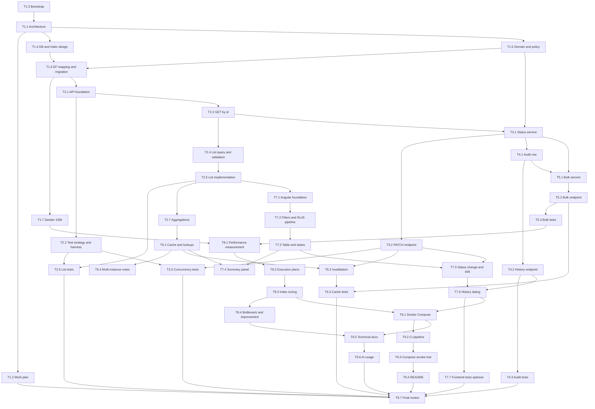

# Work Plan

The assignment is broken down into **Features → User Stories → Tasks**. Every task states what is required, the expected output, its dependencies, an effort estimate (hours of realistic hand-coding effort) and the requirement IDs it covers. Requirement IDs (R#) refer to `REQUIREMENTS.md`; the design they implement is in [ARCHITECTURE.md](ARCHITECTURE.md). The "Plan" column links each task to the execution sessions tracked in `PLAN.md` (18 sequential work units); tasks here are the finer-grained planning view.

## 1. Features

| Feature | Name | Goal | Requirements |
|---|---|---|---|
| F1 | Data & DB design | Domain model, schema, indexes, migration, 100k+ seed data | R1–R4, R16, R18, R34, R51, R61 |
| F2 | Query API | Server-side search, filter, sort, paging, aggregations; DTO-only API with solid foundations | R5–R13, R36, R49–R56 |
| F3 | Status update & concurrency | Validated transitions and lost-update prevention | R15–R19 |
| F4 | Audit & history | Status change audit trail and its endpoint | R20, R21 |
| F5 | Bulk update | Up to 100 status updates per call with defined failure semantics | R22, R23 |
| F6 | Cache | Cached aggregate with expiry and invalidation | R37–R41 |
| F7 | Angular client | Search/filter/sort/page UI, states, status change with 409, summary, history | R24–R31 |
| F8 | Performance | Measured efficiency on 100k rows, plans, indexes, bottleneck | R14, R32–R36 |
| F9 | Quality, docs & run readiness | Compose, CI, documentation, AI usage, final review | R42, R43–R48, R57–R70 |

## 2. User stories

| ID | Story | Feature | Acceptance criteria |
|---|---|---|---|
| US-1 | As an operator, I want to browse requests page by page so that I can work with 100k+ requests without waiting. | F2, F7 | Only one page is returned per call; `pageSize` ≤ 100; response has `totalCount`/`totalPages`; a page past the end returns an empty list; UI never holds the full data set |
| US-2 | As an operator, I want to filter by status, priority, organization, assignee and creation date range, and combine them, so that I can find the requests I care about. | F2, F7 | Filters combine with AND; multi-value status/priority; invalid range rejected with a clear 400; results correct on seeded data |
| US-3 | As an operator, I want to search by text and sort by several fields so that I can locate a request quickly. | F2, F7 | Prefix search on Title or Organization with wildcards treated literally; sort by createdAt, updatedAt, priority, status, title in both directions; UI debounces and cancels stale calls |
| US-4 | As a manager, I want summary counts by status and priority so that I can see workload at a glance. | F2, F6, F7 | Counts for every status/priority including zero; served from cache with a 60 s expiry; refreshed after updates |
| US-5 | As an operator, I want to change a request's status so that it reflects its progress. | F3, F7 | Only allowed transitions succeed; unknown request → 404; invalid or same status → clear 400; `UpdatedAt` and version change together |
| US-6 | As an operator, I want to be told when someone else changed the request first so that I never overwrite their work. | F3, F7 | Concurrent updates with the same version: exactly one succeeds, the others get 409 with the current state; enforced by the server and DB, not the UI; UI shows the conflict and refreshes the row |
| US-7 | As an auditor, I want every status change recorded and viewable so that I can see who changed what and when. | F4, F7 | One history row per change (request, previous, new, time, user) written atomically with the change; history endpoint and dialog show newest first |
| US-8 | As an operator, I want to update up to 100 requests at once so that routine batches are quick. | F5, F7 | ≤ 100 items; each item has its own version; response states per item updated / notFound / conflict / invalidTransition plus a summary; valid items are applied even if others fail |
| US-9 | As a maintainer, I want the API to be efficient and evidence-backed so that it stays fast at scale. | F8 | Two operations measured on 100k rows; execution plans captured; every index justified; one bottleneck and an improvement documented |
| US-10 | As an evaluator, I want to run and review the whole solution easily so that I can judge it. | F9 | One-command Compose run; README with instructions, versions, structure; CI green; decisions, limitations and AI usage documented |

## 3. Tasks

`Plan` = task number in `PLAN.md`. Estimates are hours. `NC` = non-coding task.

### F1 — Data & DB design

| ID | Task (what is required) | Expected output | Depends on | Est. | Requirements | Plan |
|---|---|---|---|---|---|---|
| T1.1 | **NC** Analyze requirements and design the architecture: layers, API contract, concurrency, bulk, cache, edge cases | `docs/ARCHITECTURE.md`, design entries in `DECISIONS.md` | T1.3 | 6 | R1, R2, R4–R23, R37–R41, R61, R64 | 2 |
| T1.2 | **NC** Break the requirements into features, stories and tasks with estimates, dependencies and traceability | `docs/WORK_PLAN.md` | T1.1 | 4 | R43–R48 | 2 |
| T1.3 | **NC** Bootstrap repository: solution, projects and references, central build settings, Angular scaffold, LocalDB connection, Compose with DB, `.gitignore`/`.editorconfig`, README stub | Building solution and frontend, `CLAUDE.md`, `REQUIREMENTS.md`, `PLAN.md`, `DECISIONS.md`, stub README | – | 4 | R0, R4, R49, R57, R59, R68 | 1 |
| T1.4 | **NC** Design the DB schema and initial index plan with a reason per index | Schema and index hypotheses (ARCHITECTURE §2, §4) | T1.1 | 3 | R2, R4, R34, R61 | 2 |
| T1.5 | Implement domain entities, enums and `StatusTransitionPolicy`, with unit tests for every transition | Domain project, unit tests passing | T1.1 | 4 | R2, R16, R42b, R51 | 3 |
| T1.6 | EF Core `DbContext`, entity configurations (tinyint enums, `rowversion`, CHECK constraints, indexes), initial migration | Migration applying cleanly to LocalDB; schema matches design | T1.4, T1.5 | 5 | R2, R4, R18, R20, R34 | 3 |
| T1.7 | Seeder CLI: migrate, wipe, bulk-insert ≥ 100k realistic rows (skewed status/priority/org distribution, nullable assignee, spread dates), re-runnable on demand | `RequestTracker.Seeder`, documented command, ≥ 100,000 rows | T1.6 | 6 | R3 | 4 |

### F2 — Query API

| ID | Task | Expected output | Depends on | Est. | Requirements | Plan |
|---|---|---|---|---|---|---|
| T2.1 | API foundation: DI composition and lifetimes, `ProblemDetails` exception handling, header → `ICurrentUser`, logging conventions, OpenAPI, `/health` with DB check, `TimeProvider` | Running API skeleton with consistent errors and validation wiring | T1.6 | 6 | R12, R13, R49–R56 | 5 |
| T2.2 | **NC + code** Define the test strategy and build the integration-test harness (`WebApplicationFactory`, unique LocalDB/SQL Server database per run, migrations, cleanup, data builders) | Test strategy section; working harness with one smoke test | T2.1 | 4 | R42, R42d | 5 |
| T2.3 | `GET /api/requests/{id}` with projection mapping, `ETag`, 404 | Endpoint + DTO + mapping class + integration test | T2.1 | 3 | R13, R15, R51 | 5 |
| T2.4 | List query model and FluentValidation rules (paging cap, date order, search length, enum values, sort fields) | Query model, validator, unit tests | T2.3 | 4 | R5–R7, R11, R55 | 6 |
| T2.5 | List implementation: composed `IQueryable` with filters, escaped prefix search, sort with tiebreaker, `COUNT` + `OFFSET/FETCH`, `AsNoTracking` + `Select` | `GET /api/requests` per contract | T2.4 | 6 | R5–R9, R12, R13, R24, R36 | 6 |
| T2.6 | List tests: happy path, combined filters, search escaping, sorting, past-end page, invalid input | Integration + unit tests passing | T2.5, T2.2 | 4 | R42a, R42b, R42d | 6 |
| T2.7 | Aggregations: counts by status and by priority (global, all members including zero) | `GET /api/requests/summary` (uncached core query) + test | T2.5 | 3 | R10, R13 | 7 |

### F3 — Status update & concurrency

| ID | Task | Expected output | Depends on | Est. | Requirements | Plan |
|---|---|---|---|---|---|---|
| T3.1 | `RequestStatusService`: load, version check, policy check, set original `RowVersion`, update `UpdatedAt`, handle `DbUpdateConcurrencyException`, explicit result types | Application service with unit tests on logic paths | T1.5, T2.3 | 5 | R15–R19 | 8 |
| T3.2 | `PATCH /api/requests/{id}/status` with `If-Match` parsing, `X-User-Name`, ordered checks, 428/400/404/409, new `ETag` | Endpoint per contract | T3.1 | 4 | R13, R15–R19, R55 | 8 |
| T3.3 | Concurrency and validation tests, including N parallel updates (exactly one winner), stale/malformed/missing version, same status, Completed | Integration tests passing | T3.2, T2.2 | 4 | R17, R19, R42b, R42c, R42d | 8 |

### F4 — Audit & history

| ID | Task | Expected output | Depends on | Est. | Requirements | Plan |
|---|---|---|---|---|---|---|
| T4.1 | Write the audit row in the same `SaveChanges` (one transaction) as the status change | History row on every successful change | T3.1 | 2 | R20 | 8 |
| T4.2 | `GET /api/requests/{id}/history` ordered by `ChangedAt` desc, `Id` desc; 404 | Endpoint + DTO + mapping | T4.1 | 3 | R15, R21 | 8 |
| T4.3 | Audit tests: one row per change, none on failures, order, empty history, 404 | Integration tests passing | T4.2 | 2 | R20, R21, R42d | 8 |

### F5 — Bulk update

| ID | Task | Expected output | Depends on | Est. | Requirements | Plan |
|---|---|---|---|---|---|---|
| T5.1 | Bulk service reusing the single-update component: one load query, classification, per-item save, conflict detach-and-continue, summary | Bulk logic with unit tests | T3.1, T4.1 | 6 | R22, R23 | 9 |
| T5.2 | `POST /api/requests/bulk-status` with whole-request validation (1–100 items, no duplicate ids, version format) | Endpoint per contract | T5.1 | 3 | R22, R55 | 9 |
| T5.3 | Bulk tests: all updated, mixed outcomes (missing/stale/invalid), duplicates, >100, empty | Integration tests passing | T5.2 | 4 | R22, R23, R42d | 9 |

### F6 — Cache

| ID | Task | Expected output | Depends on | Est. | Requirements | Plan |
|---|---|---|---|---|---|---|
| T6.1 | `IAppCache` abstraction + `HybridCache` implementation; cache summary (60 s) and lookups (10 min); `GET /api/lookups` | Cached endpoints; TTLs configurable | T2.7 | 4 | R10, R37, R38, R40 | 7 |
| T6.2 | Invalidate the summary after a committed update (single and bulk, once per bulk call) | Invalidation wired into the shared update component | T6.1, T3.2 | 1.5 | R39 | 8, 9 |
| T6.3 | Cache tests: second call served from cache, expiry, invalidation after update and bulk | Integration tests passing | T6.2, T5.2 | 2 | R37–R39 | 8, 9 |
| T6.4 | **NC** Analyze and document multi-instance behaviour and the Redis + pub/sub option | Section in docs | T6.1 | 1.5 | R41 | 7 |

### F7 — Angular client

| ID | Task | Expected output | Depends on | Est. | Requirements | Plan |
|---|---|---|---|---|---|---|
| T7.1 | Frontend foundation: routing, Material theme, `core/` (typed models, API service, user-name interceptor, current-user service), proxy | App shell calling the API | T2.5 | 6 | R31, R49, R50 | 10 |
| T7.2 | Filters and search with the RxJS pipeline (debounce 300 ms, distinct, `switchMap`, error-safe), URL query-param sync | Filter bar, store, pipeline | T7.1 | 8 | R24–R27, R31 | 11 |
| T7.3 | Results table: server-side sort and paging, Loading / Empty / Error states | Table component | T7.2 | 5 | R24, R27, R31 | 11 |
| T7.4 | Summary panel (counts by status and priority) | Summary component | T7.3, T6.1 | 3 | R29 | 12 |
| T7.5 | Status change action sending `If-Match`, 409 flow (message, refresh row), transition errors; user picker | Status-change component | T7.3, T3.2 | 6 | R28, R31 | 12 |
| T7.6 | Change-history dialog with its own states | History dialog | T7.5, T4.2 | 3 | R27, R30 | 12 |
| T7.7 | Optional: Vitest tests for the search pipeline (debounce, cancellation, error recovery) and the 409 flow | Passing frontend tests | T7.6 | 5 | R25, R26, R28 | 16 |

### F8 — Performance

| ID | Task | Expected output | Depends on | Est. | Requirements | Plan |
|---|---|---|---|---|---|---|
| T8.1 | **NC + scripts** Measure at least two central operations (list with filters/search/sort; summary or status update) on 100k rows with repeatable scripts | `perf/` scripts and timings in `docs/PERFORMANCE.md` | T1.7, T5.3 | 5 | R32 | 13 |
| T8.2 | **NC** Capture actual execution plans / `STATISTICS IO` for the main queries | Plans and I/O metrics in `docs/PERFORMANCE.md` | T8.1 | 3 | R33 | 13 |
| T8.3 | **NC + migration** Validate each index hypothesis, drop or add indexes as evidence demands, record reason per index | Final index list with reasons, migration if changed | T8.2 | 4 | R14, R34, R36 | 13 |
| T8.4 | **NC** Identify a bottleneck (e.g. deep `OFFSET`, `COUNT`, infix search) and propose an improvement (keyset paging, full-text) | Section in `docs/PERFORMANCE.md` | T8.3 | 2 | R35 | 13 |

### F9 — Quality, docs & run readiness

| ID | Task | Expected output | Depends on | Est. | Requirements | Plan |
|---|---|---|---|---|---|---|
| T9.1 | **NC + config** Run readiness: Dockerfiles for seeder, API and UI (nginx), full Compose (db → seeder → api → ui) | `docker-compose.yml`, Dockerfiles, `.env.example` | T7.6, T8.3 | 5 | R58, R67 | 14 |
| T9.2 | **NC + config** CI pipeline: build, lint, format check, backend tests against SQL Server service container, frontend build/lint/tests | `.github/workflows/ci.yml` green | T9.1 | 5 | R67, R69 | 15 |
| T9.3 | **NC + config** Compose smoke test in CI (stack up, `/health`, list call, status update) | CI job green | T9.2 | 3 | R67 | 15 |
| T9.4 | **NC** README: how to run (local and Compose), technologies and versions, solution structure | `README.md` | T9.3 | 3 | R58–R60, R69 | 17 |
| T9.5 | **NC** Technical documentation: DB choice and indexes, concurrency and bulk, cache and invalidation, two significant decisions with alternatives, one limitation and one improvement | Docs sections, links to `ARCHITECTURE.md`/`PERFORMANCE.md` | T8.4, T9.1 | 5 | R14, R23, R40, R41, R61–R65 | 17 |
| T9.6 | **NC** AI usage section: where AI was used, what was verified or changed manually (candidate completes marked placeholders) | README/docs section | T9.5 | 1.5 | R66, R70 | 17 |
| T9.7 | **NC** Final evaluator review: walk the traceability matrix, run everything from a clean clone, fix gaps | Checked matrix, clean-clone run, repo ready to submit (no ZIPs) | T9.1–T9.6, all | 4 | All (R0, R57, R67–R69) | 18 |

## 4. Effort summary

| Feature | Hours |
|---|---|
| F1 Data & DB design | 32 |
| F2 Query API | 30 |
| F3 Status update & concurrency | 13 |
| F4 Audit & history | 7 |
| F5 Bulk update | 13 |
| F6 Cache | 9 |
| F7 Angular client | 36 (31 without optional T7.7) |
| F8 Performance | 14 |
| F9 Quality, docs & run readiness | 26.5 |
| **Total** | **180.5 h** (≈ 4.5 working weeks for one developer; 175.5 h without the optional T7.7) |

The estimate is hand-coding effort for one engineer including tests and documentation, and does not reflect AI-assisted speed (A19).

## 5. Execution order and dependency graph

Order of execution: bootstrap → design → data layer → API foundation → read path → cache → write path (update, audit, bulk) → Angular (list, then write features) → performance → run readiness and CI → documentation → final review. Backend write paths (F3–F5) and the Angular list (T7.1–T7.3) can proceed in parallel once the list endpoint exists; performance work needs the seeded data and the finished API.

**Critical path:** T1.3 → T1.1 → T1.4/T1.5 → T1.6 → T2.1 → T2.3 → T2.4 → T2.5 → T7.1 → T7.2 → T7.3 → T7.5 → T7.6 → T9.1 → T9.2 → T9.3 → T9.4 → T9.7.

## 6. Traceability matrix (R0–R70 → tasks)

| Req | Tasks | Req | Tasks |
|---|---|---|---|
| R0 | T1.3, T9.7 | R36 | T2.5, T8.3 |
| R1 | T1.1 | R37 | T6.1, T6.3 |
| R2 | T1.4, T1.5, T1.6 | R38 | T6.1, T6.3 |
| R3 | T1.7 | R39 | T6.2, T6.3 |
| R4 | T1.3, T1.4, T1.6 | R40 | T6.1, T9.5 |
| R5 | T2.4, T2.5 | R41 | T6.4, T9.5 |
| R6 | T2.4, T2.5 | R42 | T2.2, T2.6, T3.3, T4.3, T5.3, T6.3, T7.7 |
| R7 | T2.4, T2.5 | R42a | T2.6, T3.3 |
| R8 | T2.5 | R42b | T1.5, T2.6, T3.3 |
| R9 | T2.5 | R42c | T3.3 |
| R10 | T2.7, T6.1 | R42d | T2.2, T2.6, T3.3, T4.3, T5.3 |
| R11 | T2.4 | R43 | T1.2 |
| R12 | T2.1, T2.5 | R44 | T1.2 |
| R13 | T2.1, T2.3, T2.5, T2.7, T3.2 | R45 | T1.2 |
| R14 | T8.3, T9.5 | R46 | T1.2 |
| R15 | T2.3, T3.1, T3.2, T4.2 | R47 | T1.2 |
| R16 | T1.5, T3.1 | R48 | T1.2 (non-coding tasks: T1.1, T1.4, T2.2, T6.4, T8.1–T8.4, T9.1–T9.7) |
| R17 | T3.1, T3.2, T3.3 | R49 | T1.3, T2.1, T7.1 |
| R18 | T1.6, T3.1 | R50 | T2.1, T7.1 |
| R19 | T3.1, T3.3 | R51 | T1.5, T2.3 |
| R20 | T1.6, T4.1, T4.3 | R52 | T2.1 |
| R21 | T4.2, T4.3 | R53 | T2.1 |
| R22 | T5.1, T5.2, T5.3 | R54 | T2.1 |
| R23 | T5.1, T5.3, T9.5 | R55 | T2.1, T2.4, T3.2, T5.2 |
| R24 | T2.5, T7.2, T7.3 | R56 | T2.1 |
| R25 | T7.2, T7.7 | R57 | T1.3, T9.7 |
| R26 | T7.2, T7.7 | R58 | T9.1, T9.4 |
| R27 | T7.2, T7.3, T7.6 | R59 | T1.3, T9.4 |
| R28 | T7.5, T7.7 | R60 | T9.4 |
| R29 | T7.4 | R61 | T1.1, T1.4, T9.5 |
| R30 | T7.6 | R62 | T9.5 |
| R31 | T7.1, T7.2, T7.3, T7.5 | R63 | T9.5 |
| R32 | T8.1 | R64 | T1.1, T9.5 |
| R33 | T8.2 | R65 | T9.5 |
| R34 | T1.4, T1.6, T8.3 | R66 | T9.6 |
| R35 | T8.4 | R67 | T9.1, T9.2, T9.3, T9.7 |
| R68 | T1.3, T9.7 | R69 | T9.2, T9.4, T9.7 |
| R70 | T9.6 | | |

Every requirement R0–R70 (including R42a–R42d) maps to at least one task. The evaluation weights in `REQUIREMENTS.md` guided the effort split: backend and Angular carry the most hours, with explicit effort reserved for performance (F8), planning (F1), tests (spread across F2–F5), cache (F6) and documentation (F9).

## 7. Risks and assumptions

| Risk / assumption | Mitigation |
|---|---|
| Compose cannot be run on the dev machine | Verified only in CI (T9.2, T9.3); files reviewed by hand |
| LocalDB differs from the container (no full-text, Windows-only) | No feature depends on the differences; final plans also checked in CI |
| Node on the dev machine is older than the Angular CLI minimum | Run frontend commands through `npx -p node@24` until Node is upgraded (D-016) |
| Index hypotheses may not hold | T8.3 validates each with plans and changes the migration if needed |
